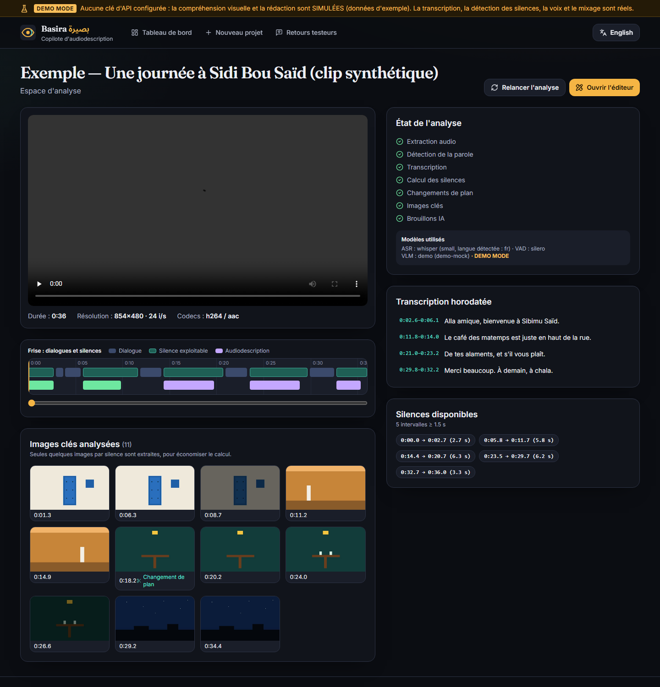
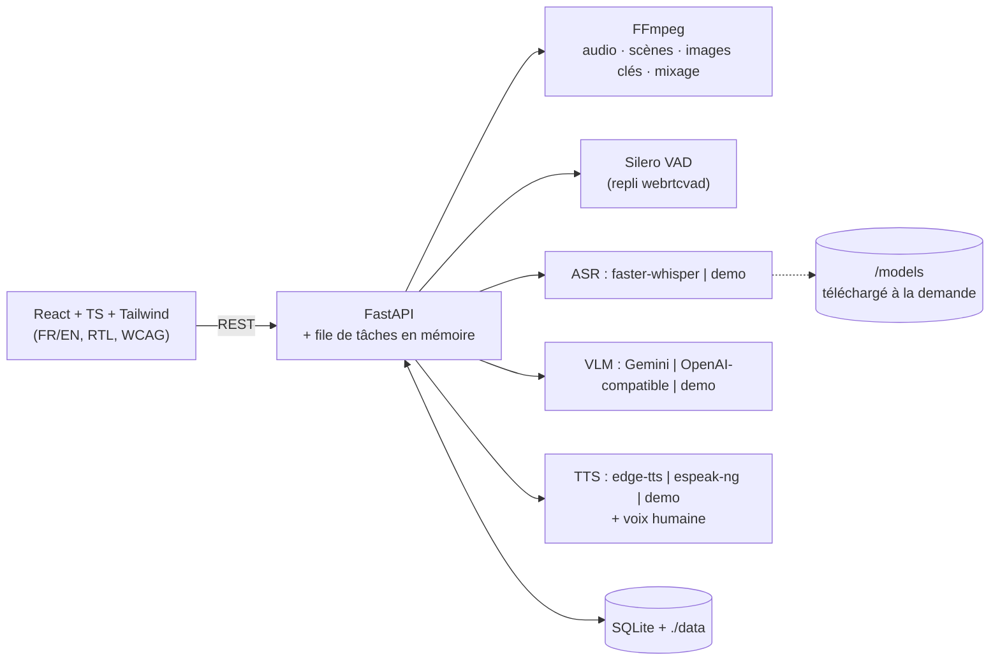

# Basira <span lang="ar">بصيرة</span> — copilote d'audiodescription assisté par IA

**Des brouillons d'audiodescription générés dans les silences des films tunisiens et francophones, relus et validés ligne par ligne par un·e audiodescripteur·rice humain·e.**

[](https://github.com/LouaySaidani/hackathonjunior/actions/workflows/ci.yml)
[](https://github.com/LouaySaidani/hackathonjunior/pkgs/container/hackathonjunior)
[](LICENSE)


> Projet réalisé pour le hackathon **OIF × JEI « IA Éthique 360 »**.
> **Basira** (*بصيرة*) signifie « clairvoyance », la vision intérieure.

---

## Le problème

« Les personnes aveugles et malvoyantes en Tunisie et dans l'espace francophone n'ont quasiment accès à aucune œuvre audiovisuelle tunisienne ou arabe audiodécrite, parce que l'audiodescription coûte des milliers d'euros par film et n'existe presque pas en arabe, ce qui les exclut de leur propre patrimoine culturel. »

## La solution

Basira divise le travail d'audiodescription en étapes que l'IA accélère, sans jamais retirer la décision à l'humain :

1. l'IA **repère les silences** du film et **propose des brouillons** de description à partir de quelques images clés ;
2. un·e **audiodescripteur·rice humain·e corrige, recale, régénère, valide ou rejette chaque ligne** ;
3. la plateforme produit la **voix**, le **mixage** et les **fichiers d'accessibilité** ;
4. des **relecteur·rice·s aveugles rémunéré·e·s** évaluent le résultat.

**Aucune ligne n'est validée automatiquement.** Chaque ligne issue de l'IA reste étiquetée comme telle jusqu'à sa validation par une personne nommée.


<details>
<summary>Autres écrans : tableau de bord, analyse, export</summary>





</details>

## Démo rapide

Prérequis : Docker. **Aucune clé d'API nécessaire** : l'application démarre en **DEMO MODE** (bannière visible), avec le clip d'exemple déjà chargé.

```bash
docker run -p 8000:8000 ghcr.io/louaysaidani/hackathonjunior:latest
```

ou, depuis un clone (données persistées dans `./data`, modèles mis en cache dans un volume) :

```bash
git clone https://github.com/LouaySaidani/hackathonjunior.git && cd hackathonjunior
docker compose up            # → http://localhost:8000
```

Ensuite : **Tableau de bord → « Essayer le clip d'exemple » → Lancer l'analyse → Éditeur → Valider → Export**.

> Au premier lancement de l'analyse, le modèle Whisper `small` (~460 Mo) est téléchargé une seule fois dans le volume `/models`.
> Sans accès réseau, l'application bascule sur la transcription de démonstration et le signale.

Pour utiliser un vrai modèle de vision, copiez `.env.example` en `.env` et renseignez `GEMINI_API_KEY`, ou `OPENAI_API_KEY` avec `OPENAI_BASE_URL` pour tout serveur compatible OpenAI (vLLM, Ollama…).

## Architecture



Détails : [docs/architecture.md](docs/architecture.md) · API : [docs/api.md](docs/api.md) (et `/docs` en direct).

## Le pipeline en 7 étapes

| # | Étape | Ce qui se passe | Technologie |
|---|---|---|---|
| 1 | **Import** | MP4/MOV/MKV, contrôle du format et de la taille, aperçu et métadonnées, **consentement obligatoire**, distribution facultative (nom et description visuelle) | FastAPI, ffprobe |
| 2 | **Analyse** | Extraction de l'audio en 16 kHz, détection de la parole, transcription horodatée, **silences ≥ 1,5 s** (avec une marge de 0,25 s), changements de plan, **1 à 3 images clés par silence** | FFmpeg, Silero VAD, faster-whisper |
| 3 | **Compréhension visuelle** | Le VLM reçoit les images clés, le dialogue autour et la distribution. **Il ne fait pas de reconnaissance faciale et n'invente rien** ; en cas d'incertitude, la ligne est marquée « À relire » | Gemini / OpenAI-compatible / demo |
| 4 | **Brouillons** | Description concise qui ne répète pas le dialogue, raccourcie ou signalée si elle dépasse la durée du silence (estimation en mots par seconde selon la langue) | `fit_to_gap` |
| 5 | **Éditeur humain** | Lecture, frise, transcription, modification du texte et du minutage, ajout manuel, suppression, régénération avec consigne, validation et rejet, raccourcis clavier. États : `BROUILLON IA` → `MODIFIÉ PAR UN HUMAIN` → `VALIDÉ PAR UN HUMAIN` (nom et date) | React |
| 6 | **Voix** | Synthèse pour les lignes validées uniquement. Si la voix arabe ou darija est insuffisante : **enregistrement au micro ou import d'une voix humaine**, par ligne ou en piste complète. Accélération légère ou coupe pour ne jamais empiéter sur le dialogue | edge-tts, espeak-ng |
| 7 | **Mixage et export** | Atténuation de la bande originale pendant les descriptions. Fichiers produits : `film_audiodecrit.mp4` (piste AD mixée + piste originale), `ad_track.mp3/.wav`, `description.vtt` (kind=descriptions), `description.ttml`, `credits.txt`, `script_ayant_droit.json`, `.zip` | FFmpeg |

S'y ajoute la page **Retours testeurs** : compréhension 1–5, préférence **arabe standard / darija / français**, commentaire libre, consentement et synthèse.

## Éthique 360

| Angle | Notre réponse de conception |
|---|---|
| **Créateurs et métiers** | L'audiodescripteur·rice est l'auteur·e : validation explicite et nominative de chaque ligne, jamais automatique. Seules les lignes validées sont vocalisées et exportées. Relecteur·rice·s aveugles **rémunéré·e·s** et associé·e·s à l'évaluation (modèle ATAA). |
| **Droits** | Case de consentement obligatoire (refus côté serveur sinon). **Aucun entraînement** sur les films importés ; opt-in désactivé par défaut. Script complet remis à l'ayant droit (`script_ayant_droit.json`). Clip d'exemple synthétique sous CC0. |
| **Données** | **Pas de reconnaissance faciale** ; personnages nommés uniquement via la distribution fournie. Stockage local, secrets côté serveur. Seules quelques images clés sont envoyées au VLM, jamais l'audio. Jeux de données ouverts de parole tunisienne recensés pour le fine-tuning (LinTO, TunSwitch, TARIC, TEDxTN). |
| **Cultures et langues** | Français, arabe standard et darija tunisienne (plus l'anglais). RTL correct dans l'interface, le VTT et le TTML. Termes culturels exacts uniquement s'ils sont visibles. **Le choix entre arabe standard et darija revient aux usagers aveugles**, et il est mesuré. |
| **Transparence** | 3 états visibles (icône et texte, jamais la couleur seule). Confiance affichée, mention « À relire », historique, texte IA d'origine conservé. Mentions IA et validation dans le VTT, le TTML, les métadonnées MP4 et `credits.txt`. Bannière **DEMO MODE** propagée jusque dans les exports. |
| **Planète** | Seuls les silences et quelques images clés sont traités. Whisper `small` quantifié en int8, **CPU par défaut**, modèles téléchargés une seule fois. |
| **Limites honnêtes** | Voir ci-dessous. Aucune statistique inventée, aucun chiffre avancé sur le nombre de personnes aveugles en Tunisie. |

Détails : [docs/ethics.md](docs/ethics.md) · Plan de validation : [docs/validation-plan.md](docs/validation-plan.md).

## Fonctionnalités implémentées

- ✅ Import MP4/MOV/MKV avec validation, aperçu, métadonnées, consentement, distribution, opt-in désactivé par défaut
- ✅ Extraction audio, **VAD Silero réel** (repli webrtcvad), **transcription faster-whisper réelle** (modèle configurable, fine-tune Hugging Face possible)
- ✅ Calcul des silences, détection des changements de plan, 1 à 3 images clés par silence
- ✅ Brouillons VLM (Gemini, OpenAI-compatible, demo), ajustés à la durée, signalés en cas de faible confiance
- ✅ Éditeur : modifier, recaler (refus serveur si chevauchement avec un dialogue), ajouter, supprimer, régénérer avec consigne, valider (nom obligatoire), rejeter, rouvrir, historique, filtres, aperçu avec l'AD, raccourcis **J/K/V/X/P/Alt+S/?**
- ✅ Synthèse vocale réelle avec edge-tts (`fr-FR-DeniseNeural`, `ar-TN-ReemNeural`), espeak-ng hors ligne, bip de démonstration signalé
- ✅ Voix humaine : enregistrement au micro ou import par ligne, ou piste complète
- ✅ Mixage avec atténuation de la bande originale, MP4 à 2 pistes, export AD MP3/WAV, WebVTT, TTML, crédits, script pour l'ayant droit, ZIP
- ✅ Tableau de bord, historique des projets, statistiques, suivi de progression des tâches (live regions ARIA)
- ✅ Page de retours des testeurs aveugles, avec synthèse
- ✅ Interface en français par défaut, bascule en anglais, arabe en RTL
- ✅ Accessibilité : HTML sémantique, lien d'évitement, focus visible, contrastes AA, **Lighthouse a11y = 100 sur les 6 pages**
- ✅ Docker multi-étapes (non-root, HEALTHCHECK), compose, CI GitHub Actions, image GHCR amd64 + arm64

## Configuration

Toutes les variables sont documentées dans [`.env.example`](.env.example).

| Variable | Défaut | Rôle |
|---|---|---|
| `ASR_PROVIDER` | `auto` | `whisper` · `demo` · `auto` (whisper, repli demo signalé) |
| `WHISPER_MODEL` | `small` | Taille faster-whisper **ou identifiant HF** d'un modèle CTranslate2 (ex. fine-tune tunisien) |
| `WHISPER_DEVICE` / `WHISPER_COMPUTE_TYPE` | `cpu` / `int8` | `cuda` / `float16` sur GPU (`docker-compose.gpu.yml`) |
| `VLM_PROVIDER` | `auto` | `gemini` · `openai` · `demo` · `auto` (selon les clés présentes) |
| `GEMINI_API_KEY`, `GEMINI_MODEL` | — / `gemini-2.5-flash` | Fournisseur Gemini |
| `OPENAI_API_KEY`, `OPENAI_BASE_URL`, `OPENAI_MODEL` | — / OpenAI / `gpt-4o-mini` | Tout serveur compatible OpenAI |
| `TTS_PROVIDER` | `auto` | `edge` → `espeak` → `demo` |
| `TTS_VOICE_FR` / `_AR` / `_EN` | Denise / Reem (ar-TN) / Sonia | Voix |
| `VAD_ENGINE` | `silero` | `silero` · `webrtc` |
| `MIN_GAP_SECONDS` / `GAP_PADDING_SECONDS` | `1.5` / `0.25` | Silences exploitables |
| `CONFIDENCE_THRESHOLD` | `0.6` | En dessous : « À relire » |
| `DUCK_VOLUME` | `0.25` | Niveau de la bande originale pendant l'AD |
| `MAX_UPLOAD_MB`, `SEED_SAMPLE`, `DATA_DIR`, `MODELS_DIR` | `500`, `true`, `./data`, `./models` | Stockage |

## Développement local

Prérequis : Python 3.11, Node 22, FFmpeg (et espeak-ng en option).

```bash
python3.11 -m venv .venv && . .venv/bin/activate      # Windows : .venv\Scripts\activate
pip install -r backend/requirements-dev.txt
cd frontend && npm ci && npm run build && cd ..
cd backend && uvicorn app.main:app --reload --port 8000  # → http://localhost:8000
# Interface en rechargement à chaud : cd frontend && npm run dev  → http://localhost:5173 (proxy /api)
```

Raccourcis : `make install`, `make backend`, `make frontend`, `make test`, `make lint`, `make up`, `make notebook`.

## Tests

```bash
cd backend && pytest -q        # 20 tests : silences/VAD réel, ajustement, VTT/TTML/crédits, fournisseurs (HTTP simulé), parcours API complet
ruff check .                   # lint
cd ../frontend && npm run build
```

- Le notebook [`notebooks/pipeline_demo.ipynb`](notebooks/pipeline_demo.ipynb) exécute le pipeline de bout en bout en DEMO MODE (vérifié en CI).
- Audit d'accessibilité Lighthouse : **100/100** sur le tableau de bord, le nouveau projet, l'analyse, l'éditeur, l'export et les retours.

## Feuille de route

- **Fine-tuning darija** de Whisper sur LinTO, TunSwitch, TARIC et TEDxTN (selon leurs licences), puis conversion CTranslate2 et branchement via `WHISPER_MODEL`.
- **Cohérence des personnages** d'une scène à l'autre, sans reconnaissance faciale (vêtements et position, à partir de la distribution).
- **Édition collaborative** (plusieurs audiodescripteur·rice·s, relecture croisée, commentaires).
- **Tableau de bord d'évaluation** des retours des testeurs (par langue, par extrait, dans le temps).
- Profils TTML pour la diffusion (EBU-TT-D, IMSC), Piper TTS hors ligne, stockage objet, déploiement cloud.

## Limites honnêtes

- **DEMO MODE** : sans clé d'API, la compréhension visuelle est **simulée**. Pour le clip d'exemple, elle renvoie un script de référence écrit à la main ; pour toute autre vidéo, une ligne générique calculée à partir des couleurs réelles de l'image, à faible confiance. La bannière et les exports le signalent. Les intégrations Gemini et OpenAI-compatible sont implémentées et testées avec des réponses HTTP simulées, **mais n'ont pas été testées avec une vraie clé** pendant le hackathon.
- **Réel pendant le hackathon** : FFmpeg, Silero VAD, faster-whisper `small` sur CPU, edge-tts (FR et ar-TN), mixage, exports.
- **Darija** : Whisper générique transcrit mal la darija et l'alternance arabe/français ; la voix `ar-TN` lit le darija de façon approximative. D'où l'enregistrement de voix humaine et le fine-tuning prévu.
- **edge-tts** nécessite Internet ; hors ligne, l'application bascule sur espeak-ng (voix robotique) puis sur un bip, en le signalant.
- La détection de scène par score FFmpeg ne repère pas toujours les fondus progressifs ; une image clé au milieu de chaque silence est toujours extraite.
- Débit de parole estimé en mots par seconde : c'est une approximation, la durée réelle de l'audio est vérifiée au moment de la voix.
- File de tâches en mémoire : une tâche interrompue par un redémarrage est marquée en erreur et doit être relancée.
- **Modèle économique** : en Tunisie, personne n'est légalement tenu de financer l'audiodescription. Pistes : festivals (JCC…), télévision publique (Al Wataniya), subventions OIF, UE ou ambassades, mécénat. Basira vise à baisser le coût par film, pas à supprimer le métier.
- Nous ne donnons **aucune statistique** sur le nombre de personnes aveugles en Tunisie : nous n'avons pas de source vérifiée.

## Licences des données et des modèles

| Élément | Licence |
|---|---|
| Code de Basira | Apache-2.0 ([LICENSE](LICENSE)) |
| Clip d'exemple, transcription et script de référence | CC0 1.0 ([samples/LICENSE.md](samples/LICENSE.md)) |
| faster-whisper / CTranslate2 | MIT ; poids Whisper d'OpenAI sous MIT |
| Silero VAD | MIT |
| FFmpeg | LGPL/GPL (binaire système, non redistribué dans le dépôt) |
| espeak-ng | GPL-3.0 (paquet système de l'image Docker) |
| edge-tts | Bibliothèque sous LGPL-3.0 ; service vocal de Microsoft soumis à ses conditions |
| Gemini / modèles OpenAI-compatibles | Conditions de chaque fournisseur ; non utilisés en DEMO MODE |
| LinTO, TunSwitch, TARIC, TEDxTN (prévus pour le fine-tuning, non inclus) | Voir la licence de chaque jeu de données à sa source |

## Équipe

Équipe **hackathonjunior**, hackathon OIF × JEI « IA Éthique 360 ».

## Remerciements

À l'Organisation internationale de la Francophonie et à la JEI pour le hackathon ; aux associations de personnes aveugles et malvoyantes et aux audiodescripteur·rice·s, dont le travail inspire cet outil ; aux communautés open source de FFmpeg, faster-whisper, Silero, espeak-ng et edge-tts.

---

## English summary

**Basira** is a human-in-the-loop **AI audio description co-pilot** for Tunisian and Francophone films. It finds silent gaps (FFmpeg + Silero VAD + faster-whisper), extracts only 1–3 keyframes per gap, and asks a vision-language model (Gemini, any OpenAI-compatible endpoint, or a clearly-labelled DEMO provider) for short drafts in **French, Modern Standard Arabic or Tunisian darija**. A human describer edits, re-times, regenerates, **validates (by name) or rejects every line**; nothing is ever auto-validated and only validated lines are voiced and exported. Voice comes from edge-tts/espeak-ng or **human recordings**. Exports: ducked MP4, AD track, WebVTT (kind=descriptions, RTL-aware), TTML, credits and a script delivered to the rights holder. Includes a blind-tester feedback page, FR/EN UI, Lighthouse accessibility 100, Docker image (`docker run -p 8000:8000 ghcr.io/louaysaidani/hackathonjunior:latest`) and CI. Without API keys it runs in an explicit **DEMO MODE**.
