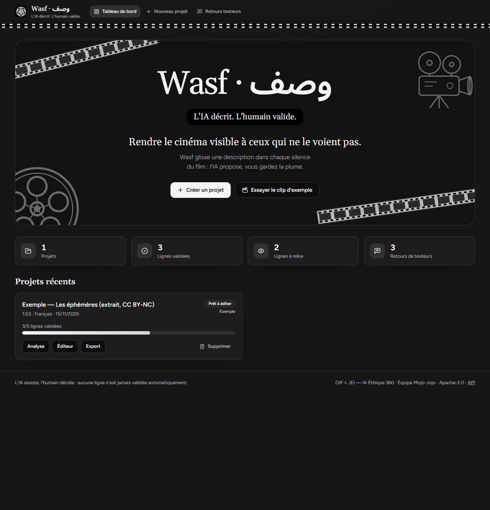
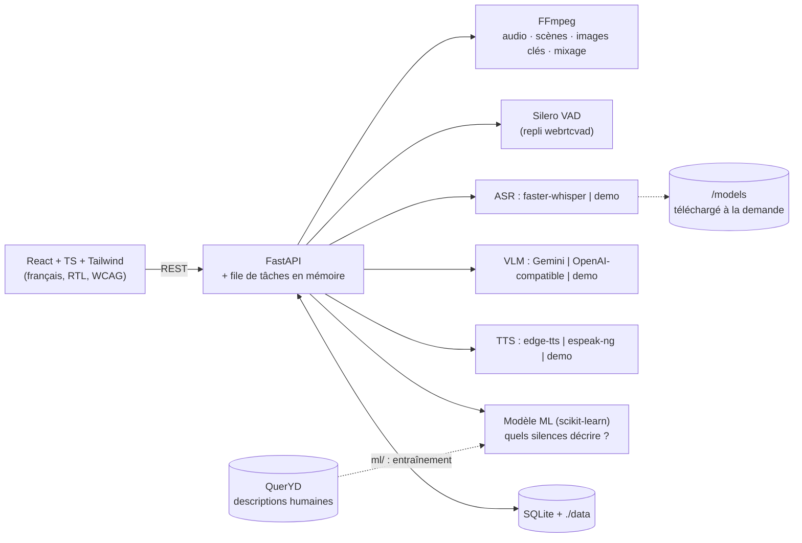
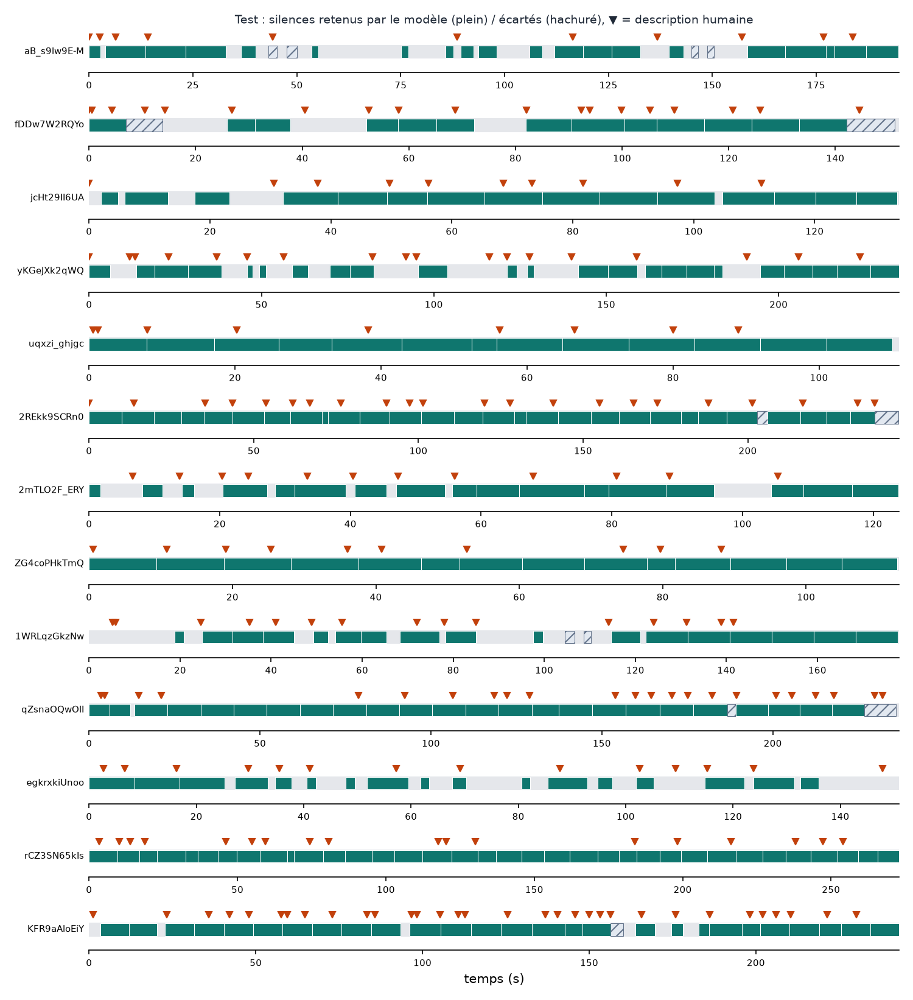

# Wasf <span lang="ar">وصف</span> — copilote d'audiodescription assisté par IA

<p align="center"></p>

**Des brouillons d'audiodescription générés dans les silences des films tunisiens et francophones, relus et validés ligne par ligne par un·e audiodescripteur·rice humain·e.**

[](https://github.com/LouaySaidani/hackathonjunior/actions/workflows/ci.yml)
[](LICENSE)


> Projet réalisé pour le hackathon **OIF × JEI « IA Éthique 360 »**.
> **Wasf** (*وصف*) signifie « description » en arabe. *L'IA décrit. L'humain valide.*

> [!NOTE]
> **Phase 1 du hackathon : un prototype, pas une version finale.**
> - **Langues** : le parcours complet a été développé et testé en **français**. L'**arabe standard** et la **darija** sont sélectionnables, mais encore **en cours de test**.
> - **Rédaction des brouillons** : elle passe pour l'instant par **Gemini**, un LLM multimodal en ligne de Google. En phase 2, nous voulons entraîner **notre propre modèle de description**, dédié à l'audiodescription et attentif au contexte du film.
> - **Choix des scènes à décrire** : notre modèle ML est entraîné et mesuré, mais il n'est **pas encore parfait** : avec 17 vidéos d'entraînement, il ne fait pas mieux que « tout décrire ». C'est pourquoi l'humain garde toujours la décision.
>
> Détails : [Limites honnêtes](#limites-honnêtes) · [Feuille de route](#feuille-de-route).

---

## Le problème

« Les personnes aveugles et malvoyantes en Tunisie et dans l'espace francophone n'ont quasiment accès à aucune œuvre audiovisuelle tunisienne ou arabe audiodécrite, parce que l'audiodescription coûte des milliers d'euros par film et n'existe presque pas en arabe, ce qui les exclut de leur propre patrimoine culturel. »

## La solution

Wasf divise le travail d'audiodescription en étapes que l'IA accélère, sans jamais retirer la décision à l'humain :

1. l'IA **repère les silences** du film et **propose des brouillons** de description à partir de quelques images clés ;
2. un·e **audiodescripteur·rice humain·e corrige, recale, régénère, valide ou rejette chaque ligne** ;
3. la plateforme produit la **voix**, le **mixage** et les **fichiers d'accessibilité** ;
4. des **relecteur·rice·s aveugles rémunéré·e·s** évaluent le résultat.

**Aucune ligne n'est validée automatiquement.** Chaque ligne issue de l'IA reste étiquetée comme telle jusqu'à sa validation par une personne nommée.

<p align="center"></p>

<table>
<tr>
<td width="50%" valign="top"></td>
<td width="50%" valign="top"></td>
</tr>
<tr>
<td><b>Analyse</b> : Whisper transcrit les dialogues, Wasf trouve les silences et les découpe en créneaux, le modèle ML donne à chaque créneau un score de pertinence, puis Gemini rédige à partir des images clés.</td>
<td><b>Éditeur</b> : chaque brouillon est relu, corrigé, recalé, puis <b>validé par une personne nommée</b>. Seules les lignes validées sont vocalisées et mixées dans le film.</td>
</tr>
</table>

<sub>Captures réelles sur la vidéo d'exemple (extrait de film protégé, usage limité à ce dépôt privé : voir <code>samples/LICENSE.md</code>) : 17 brouillons rédigés par <code>gemini-3.6-flash</code> en 2 requêtes, relus dans l'éditeur ; 13 lignes validées et vocalisées avec <code>fr-FR-DeniseNeural</code>.</sub>

<details>
<summary>Autres écrans : tableau de bord, export</summary>




</details>

## Installation et lancement

Wasf s'installe et se lance sur votre ordinateur. Comptez **15 à 20 minutes** la première fois, avec une connexion Internet.

### 1. Installer les outils (une seule fois)

| Outil | Version | Rôle | Vérification |
|---|---|---|---|
| **Git** | récente | récupérer le code | `git --version` |
| **Python** | **3.11** | serveur et pipeline d'IA | `py -3.11 --version` (Windows) ou `python3.11 --version` |
| **Node.js** | **22 ou plus** | construire l'interface web | `node --version` |
| **FFmpeg** | récente | audio, images clés, mixage | `ffmpeg -version` |
| espeak-ng | *facultatif* | voix de secours sans Internet | `espeak-ng --version` |

**Windows** (PowerShell) :

```powershell
winget install -e --id Git.Git
winget install -e --id Python.Python.3.11
winget install -e --id OpenJS.NodeJS.LTS
winget install -e --id Gyan.FFmpeg
```

**Fermez puis rouvrez PowerShell** pour que les nouveaux outils soient trouvés, puis vérifiez avec les commandes de la dernière colonne.

**Linux** (Debian/Ubuntu) : `sudo apt install git python3.11 python3.11-venv nodejs npm ffmpeg espeak-ng`. **macOS** (Homebrew) : `brew install git python@3.11 node ffmpeg espeak-ng`.

### 2. Récupérer le code

```powershell
git clone https://github.com/LouaySaidani/hackathonjunior.git
cd hackathonjunior
```

> Le dépôt est privé : il faut avoir été invité sur GitHub.

### 3. Installer les dépendances Python

```powershell
py -3.11 -m venv .venv                                       # Linux/macOS : python3.11 -m venv .venv
.venv\Scripts\python -m pip install --upgrade pip              # Linux/macOS : .venv/bin/python …
.venv\Scripts\python -m pip install -r backend\requirements.txt
```

### 4. Construire l'interface web

```powershell
cd frontend
npm ci
npm run build
cd ..
```

> Un avertissement `npm warn install-scripts … esbuild` peut s'afficher : il est sans conséquence.

### 5. Configurer (facultatif)

```powershell
copy .env.example .env                                       # Linux/macOS : cp .env.example .env
```

Sans clé, Wasf démarre en **DEMO MODE** (bannière visible) : la vidéo d'exemple reçoit des descriptions préparées à l'avance et relues par un humain. Pour de vraies descriptions, ouvrez `.env` et renseignez `GEMINI_API_KEY` ([clé gratuite sur Google AI Studio](https://aistudio.google.com/apikey)).

> **Quota gratuit Gemini** : environ 20 requêtes par jour et par modèle. Wasf décrit 8 créneaux par requête (un extrait de 2 minutes coûte 2 requêtes) et passe automatiquement à un modèle « lite » quand le quota est épuisé.

### 6. Lancer Wasf

```powershell
cd backend
..\.venv\Scripts\python -m uvicorn app.main:app --port 8000      # Linux/macOS : ../.venv/bin/python -m uvicorn …
```

Ouvrez **<http://localhost:8000>**. Pour arrêter : `Ctrl+C` dans le terminal. Pour relancer plus tard : refaites seulement l'étape 6.

### 7. Premier essai

**Tableau de bord → « Essayer le clip d'exemple » → Lancer l'analyse → Éditeur → Valider → Export.**

> À la première analyse, le modèle Whisper `small` (~460 Mo) est téléchargé une seule fois dans `models/`.

### En cas de problème

| Message | Solution |
|---|---|
| `ffmpeg` ou `node` n'est pas reconnu | fermez et rouvrez le terminal après l'installation (étape 1) |
| « Frontend non construit » | refaites l'étape 4 |
| le port 8000 est déjà utilisé | lancez avec `--port 8001` et ouvrez <http://localhost:8001> |
| voix remplacée par un bip | pas d'Internet pour la voix edge-tts : installez espeak-ng (voix de secours) |

### Parcours complet : de la vidéo au film audiodécrit

1. **Nouveau projet** : importez la vidéo, cochez le consentement, choisissez la langue de description.
2. **Analyse → Lancer l'analyse** : silences, créneaux, scores ML et brouillons Gemini (de 30 s à 2 min).
3. **Éditeur** : indiquez votre nom, relisez chaque ligne et cliquez **Valider** (raccourcis **J/K** pour naviguer, **V** pour valider, **X** pour rejeter), ou **Tout valider** une fois la relecture faite. Un brouillon non validé reste muet.
4. **Export → Générer les voix des lignes validées → Générer l'export**, puis téléchargez `film_audiodecrit.mp4`.

### Vidéos pour tester

```bash
bash scripts/get_test_videos.sh     # 4 extraits de films libres de la Blender Foundation (CC-BY) dans videos_test/
```

| Vidéo | Durée | Intérêt |
|---|---|---|
| `05_sintel_bande_annonce.mp4` | 52 s | premier essai, environ 1 requête Gemini |
| `04_caminandes_llama_drama.mp4` | 1 min 30 | animation comique sans dialogue |
| `01_tears_of_steel_dialogue.mp4` | 2 min 30 | prises de vue réelles, dialogues et silences (celle des captures) |
| `03_spring_sans_dialogue.mp4` | 2 min 30 | aucun dialogue : découpage en créneaux de 10 s |

Licence CC-BY : vous pouvez les montrer en public en citant l'œuvre et la Blender Foundation (crédits dans `videos_test/CREDITS.md`). Pour comparer avec de **vraies audiodescriptions humaines**, utilisez les 13 vidéos de test QuerYD téléchargées par `python ml/run_all.py` (voir [ml/README.md](ml/README.md)).

## Architecture

<p align="center"></p>



Détails : [docs/architecture.md](docs/architecture.md) · API : [docs/api.md](docs/api.md) (et `/docs` en direct).

## Le pipeline en 7 étapes

| # | Étape | Ce qui se passe | Technologie |
|---|---|---|---|
| 1 | **Import** | MP4/MOV/MKV, contrôle du format et de la taille, aperçu et métadonnées, **consentement obligatoire**, distribution facultative (nom et description visuelle) | FastAPI, ffprobe |
| 2 | **Analyse** | Extraction de l'audio en 16 kHz, détection de la parole, transcription horodatée, **silences ≥ 1,5 s** (avec une marge de 0,25 s), changements de plan, **découpage des longs silences en créneaux d'environ 10 s** (aux changements de plan), **score de pertinence ML** de chaque créneau, **1 à 3 images clés par créneau** | FFmpeg, Silero VAD, faster-whisper, scikit-learn |
| 3 | **Compréhension visuelle** | Le VLM reçoit les images clés, le dialogue autour et la distribution. **Il ne fait pas de reconnaissance faciale et n'invente rien** ; en cas d'incertitude, la ligne est marquée « À relire » | Gemini / OpenAI-compatible / demo |
| 4 | **Brouillons** | Description concise qui ne répète pas le dialogue, raccourcie ou signalée si elle dépasse la durée du silence (estimation en mots par seconde selon la langue) | `fit_to_gap` |
| 5 | **Éditeur humain** | Lecture, frise, transcription, modification du texte et du minutage, ajout manuel, suppression, régénération avec consigne, validation et rejet (ligne par ligne ou **« Tout valider »** après relecture), raccourcis clavier. États : `BROUILLON IA` → `MODIFIÉ PAR UN HUMAIN` → `VALIDÉ PAR UN HUMAIN` (nom et date) | React |
| 6 | **Voix** | Synthèse vocale pour les lignes validées uniquement : la voix est toujours générée, l'humain travaille sur le texte. Accélération légère ou coupe pour ne jamais empiéter sur le dialogue | edge-tts, espeak-ng |
| 7 | **Mixage et export** | Atténuation de la bande originale pendant les descriptions. Fichiers produits : `film_audiodecrit.mp4` (piste AD mixée + piste originale), `ad_track.mp3/.wav`, `description.vtt` (kind=descriptions), `description.ttml`, `credits.txt`, `script_ayant_droit.json`, `.zip` | FFmpeg |

S'y ajoute la page **Retours testeurs** : compréhension 1–5, préférence **arabe standard / darija / français**, commentaire libre, consentement et synthèse.

## Apprentissage automatique : où décrire ?

Un·e audiodescripteur·rice ne décrit pas tous les silences, et décrit un long passage muet en plusieurs fois. Nous avons entraîné un modèle sur **des descriptions écrites par des humains** pour apprendre où les placer.

| | Rôle | Entraîné par nous ? |
|---|---|---|
| VAD + Whisper | trouver les silences | non |
| **Modèle ML** ([`ml/`](ml/)) | **choisir les créneaux à décrire** | **oui** |
| Gemini | écrire ce qui se passe à l'image | non (pré-entraîné) |
| edge-tts + FFmpeg | voix et mixage | non |

**Données.** [QuerYD](https://www.robots.ox.ac.uk/~vgg/data/queryd/) (Oxford, ICASSP 2021) : vidéos YouTube audiodécrites par les bénévoles de [YouDescribe](https://youdescribe.org), avec l'horodatage et le type de chaque description. On conserve uniquement les horaires, le type et le texte des descriptions ; les noms et e-mails des bénévoles sont supprimés. Nous avons pris **30 vidéos** (films, courts métrages d'animation, extraits) : **17 pour l'entraînement, 13 pour le test**. Chaque vidéo n'appartient qu'à un seul des deux ensembles.

**Méthode.** Chaque vidéo passe par **le pipeline de Wasf lui-même**. Chaque créneau reçoit 24 variables : durée, dialogue autour, changements de plan, mouvement, luminosité, niveau sonore, musique. Il est étiqueté 1 si un humain y a commencé une description. On compare trois modèles (régression logistique, forêt aléatoire, gradient boosting) en validation croisée par vidéo. Le seuil de décision est choisi sur l'entraînement uniquement.

**Ce que les données nous ont appris.** La première version donnait **un seul brouillon par silence**, même pour 150 s sans dialogue, alors que les humains décrivent environ toutes les 10 à 25 s. Wasf **découpe désormais les longs silences en créneaux d'environ 10 s**, aux changements de plan. Résultat : **91 % des descriptions humaines** (407 sur 448) commencent dans un créneau où Wasf peut rédiger.

**Résultats sur les 13 vidéos de test** (276 créneaux, [rapport complet](ml/reports/report.md)) :

| Méthode | Précision | Rappel | F1 | Créneaux rédigés |
|---|---|---|---|---|
| Tous les créneaux (sans ML) | 61 % | 100 % | 0,76 | 100 % |
| Règle de durée (≥ 3 s) | 65 % | 95 % | 0,77 | 89 % |
| Modèle ML (régression logistique) | 62 % | 96 % | 0,75 | 95 % |

<p align="center"></p>

**Lecture honnête.**
- Le modèle apprend un vrai signal : sa précision moyenne (AP) est de 0,74 contre 0,61 au hasard (IC 95 % : 0,67–0,81).
- Les variables les plus utiles sont la durée du créneau, le niveau sonore (musique, bruitages), le premier créneau de la vidéo et les changements de luminosité.
- Mais avec 17 vidéos d'entraînement, il **ne fait pas mieux que « décrire tous les créneaux »**, car les humains en décrivent déjà 61 %. Dans l'application, il garde donc 95 % des créneaux.
- La suite : plus de vidéos (`--train 80 --test 20`, sans changer le code) et des films tunisiens annotés.

**Dans l'application.** Chaque créneau affiche son score de pertinence. Gemini rédige dans les créneaux retenus. Les autres apparaissent en pointillés, avec un bouton **« Rédiger ici »** : le modèle propose, l'humain décide.

```bash
pip install -r ml/requirements.txt
python ml/run_all.py --train 17 --test 13   # télécharge, analyse, entraîne, évalue (15 à 30 min sur CPU)
```

Détails, variables et vidéos de test : [ml/README.md](ml/README.md).

## Éthique 360

| Angle | Notre réponse de conception |
|---|---|
| **Créateurs et métiers** | L'audiodescripteur·rice est l'auteur·e : validation explicite et nominative de chaque ligne, jamais automatique. Seules les lignes validées sont vocalisées et exportées. Relecteur·rice·s aveugles **rémunéré·e·s** et associé·e·s à l'évaluation (modèle ATAA). |
| **Droits** | Case de consentement obligatoire (refus côté serveur sinon). **Aucun entraînement** sur les films importés ; opt-in désactivé par défaut. Script complet remis à l'ayant droit (`script_ayant_droit.json`). Clip de test synthétique sous CC0 ; la vidéo d'exemple est un extrait protégé, réservé au test dans ce dépôt privé. |
| **Données** | **Pas de reconnaissance faciale** ; personnages nommés uniquement via la distribution fournie. Stockage local, secrets côté serveur. Seules quelques images clés et le dialogue voisin (en texte) sont envoyés au VLM (Gemini, service en ligne), jamais l'audio ni le film entier. Le texte des lignes validées est envoyé au service vocal de Microsoft (edge-tts) ; espeak-ng permet de rester hors ligne. Jeux de données ouverts de parole tunisienne recensés pour le fine-tuning (LinTO, TunSwitch, TARIC, TEDxTN). |
| **Cultures et langues** | Français, arabe standard et darija tunisienne (phase 1 : testé en français ; arabe et darija en cours de test). RTL correct dans l'interface, le VTT et le TTML. Termes culturels exacts uniquement s'ils sont visibles. **Le choix entre arabe standard et darija revient aux usagers aveugles**, et il est mesuré. |
| **Transparence** | 3 états visibles (icône et texte, jamais la couleur seule). Confiance affichée, mention « À relire », historique, texte IA d'origine conservé. Mentions IA et validation dans le VTT, le TTML, les métadonnées MP4 et `credits.txt`. Bannière **DEMO MODE** propagée jusque dans les exports. |
| **Planète** | Seuls les silences et quelques images clés sont traités. Whisper `small` quantifié en int8, **CPU par défaut**, modèles téléchargés une seule fois. |
| **Limites honnêtes** | Voir ci-dessous. Aucune statistique inventée, aucun chiffre avancé sur le nombre de personnes aveugles en Tunisie. |

Détails : [docs/ethics.md](docs/ethics.md) · Plan de validation : [docs/validation-plan.md](docs/validation-plan.md).

## Fonctionnalités implémentées

- ✅ Import MP4/MOV/MKV avec validation, aperçu, métadonnées, consentement, distribution, opt-in désactivé par défaut
- ✅ Extraction audio, **VAD Silero réel** (repli webrtcvad), **transcription faster-whisper réelle** (modèle configurable, fine-tune Hugging Face possible)
- ✅ Calcul des silences, détection des changements de plan, découpage des longs silences en créneaux d'environ 10 s, 1 à 3 images clés par créneau
- ✅ **Modèle ML entraîné sur des descriptions humaines** (QuerYD) : score de pertinence par créneau, sélection des créneaux à rédiger, bouton « Rédiger ici », processus complet dans [`ml/`](ml/) (données, variables, entraînement, évaluation, rapport)
- ✅ Brouillons VLM (Gemini, OpenAI-compatible, demo), ajustés à la durée, signalés en cas de faible confiance, nouvelles tentatives automatiques si Gemini est surchargé
- ✅ Éditeur : modifier, recaler (refus serveur si chevauchement avec un dialogue), ajouter, supprimer, régénérer avec consigne, valider (nom obligatoire), **tout valider en une fois** (nom obligatoire, lignes trop longues exclues), rejeter, rouvrir, historique, filtres, aperçu avec l'AD, raccourcis **J/K/V/X/P/Alt+S/?**
- ✅ Synthèse vocale réelle avec edge-tts (`fr-FR-DeniseNeural`, `ar-TN-ReemNeural`), espeak-ng hors ligne, bip de démonstration signalé
- ✅ Mixage avec atténuation de la bande originale, MP4 à 2 pistes, export AD MP3/WAV, WebVTT, TTML, crédits, script pour l'ayant droit, ZIP
- ✅ Tableau de bord, historique des projets, statistiques, suivi de progression des tâches (live regions ARIA)
- ✅ Page de retours des testeurs aveugles, avec synthèse
- ✅ Interface en français, textes arabes affichés de droite à gauche (RTL)
- ✅ Accessibilité : HTML sémantique, lien d'évitement, focus visible, contrastes AA, **Lighthouse a11y = 100 sur les 6 pages**
- ✅ CI GitHub Actions : lint, tests, notebook et construction de l'interface

## Configuration

Toutes les variables sont documentées dans [`.env.example`](.env.example).

| Variable | Défaut | Rôle |
|---|---|---|
| `ASR_PROVIDER` | `auto` | `whisper` · `demo` · `auto` (whisper, repli demo signalé) |
| `WHISPER_MODEL` | `small` | Taille faster-whisper **ou identifiant HF** d'un modèle CTranslate2 (ex. fine-tune tunisien) |
| `WHISPER_DEVICE` / `WHISPER_COMPUTE_TYPE` | `cpu` / `int8` | `cuda` / `float16` sur carte graphique NVIDIA |
| `VLM_PROVIDER` | `auto` | `gemini` · `openai` · `demo` · `auto` (selon les clés présentes) |
| `GEMINI_API_KEY`, `GEMINI_MODEL` | — / `gemini-3.6-flash` | Fournisseur Gemini |
| `GEMINI_FALLBACK_MODELS` / `VLM_BATCH_SIZE` | `gemini-3.5-flash-lite,gemini-flash-lite-latest` / `8` | Modèles de secours quand le quota du jour est épuisé ; créneaux décrits par requête |
| `OPENAI_API_KEY`, `OPENAI_BASE_URL`, `OPENAI_MODEL` | — / OpenAI / `gpt-4o-mini` | Tout serveur compatible OpenAI |
| `TTS_PROVIDER` | `auto` | `edge` → `espeak` → `demo` |
| `TTS_VOICE_FR` / `_AR` | Denise / Reem (ar-TN) | Voix |
| `VAD_ENGINE` | `silero` | `silero` · `webrtc` |
| `MIN_GAP_SECONDS` / `GAP_PADDING_SECONDS` | `1.5` / `0.25` | Silences exploitables |
| `MAX_SLOT_SECONDS` | `10` | Longueur maximale d'un créneau (les longs silences sont découpés) ; `0` = pas de découpage |
| `CONFIDENCE_THRESHOLD` | `0.6` | En dessous : « À relire » |
| `DUCK_VOLUME` | `0.25` | Niveau de la bande originale pendant l'AD |
| `GAP_SELECTION` | `auto` | `auto` (modèle ML s'il est entraîné, sinon tous les silences) · `model` · `all` |
| `GAP_SCORE_THRESHOLD` / `GAP_MODEL_PATH` | `0` (seuil appris) / `ml/artifacts/gap_scorer.joblib` | Sélection ML des silences |
| `MAX_UPLOAD_MB`, `SEED_SAMPLE`, `DATA_DIR`, `MODELS_DIR` | `500`, `true`, `./data`, `./models` | Stockage |
| `SAMPLE_VIDEO` / `SAMPLE_TITLE` | `samples/vd_test.mp4` / « Exemple — extrait de film (test) » | Vidéo du projet d'exemple. Une vidéo locale peut aller dans `samples/local/` (ignoré par git). En DEMO MODE, une transcription et un script de référence sont utilisés s'ils sont fournis à côté de la vidéo (`<nom>.transcript.json`, `<nom>.script.json`) |

## Développement

Après l'installation ci-dessus :

```powershell
.venv\Scripts\python -m pip install -r backend\requirements-dev.txt     # outils de test et de lint
cd backend
..\.venv\Scripts\python -m uvicorn app.main:app --reload --port 8000    # rechargement automatique du serveur
```

Pour modifier l'interface avec rechargement à chaud : `cd frontend` puis `npm run dev`, et ouvrez <http://localhost:5173> (les appels `/api` sont relayés vers le port 8000).

## Tests

```powershell
cd backend
..\.venv\Scripts\python -m pytest -q     # 49 tests : silences/VAD réel, créneaux, ajustement, VTT/TTML/crédits, fournisseurs (HTTP simulé), quota Gemini, sélection ML, parcours API complet, migrations
..\.venv\Scripts\ruff check .            # lint
cd ..\frontend
npm run build
```

- Le notebook [`notebooks/pipeline_demo.ipynb`](notebooks/pipeline_demo.ipynb) exécute le pipeline de bout en bout en DEMO MODE (vérifié en CI).
- Audit d'accessibilité Lighthouse : **100/100** sur le tableau de bord, le nouveau projet, l'analyse, l'éditeur, l'export et les retours.

## Feuille de route

- **Notre propre modèle de description** (phase 2) : un modèle entraîné pour l'audiodescription, qui tient compte du contexte du film (scènes précédentes, personnages, dialogue), pour remplacer Gemini et pouvoir fonctionner en local.
- **Meilleur choix des scènes à décrire** : réentraîner le modèle ML sur plus de vidéos (`--train 80 --test 20`) et sur des films francophones et tunisiens annotés, puis trier l'ordre de relecture par score.
- **Arabe standard et darija** : terminer les tests avec des locuteurs natifs et des usagers aveugles.
- **Fine-tuning darija** de Whisper sur LinTO, TunSwitch, TARIC et TEDxTN (selon leurs licences), puis conversion CTranslate2 et branchement via `WHISPER_MODEL`.
- **Cohérence des personnages** d'une scène à l'autre, sans reconnaissance faciale (vêtements et position, à partir de la distribution).
- **Édition collaborative** (plusieurs audiodescripteur·rice·s, relecture croisée, commentaires).
- **Tableau de bord d'évaluation** des retours des testeurs (par langue, par extrait, dans le temps).
- Profils TTML pour la diffusion (EBU-TT-D, IMSC), Piper TTS hors ligne, stockage objet, déploiement cloud.

## Limites honnêtes

- **Phase 1** : Wasf est un prototype de hackathon. Tout n'est pas terminé, et c'est assumé : les points ci-dessous disent ce qui marche, ce qui reste à tester et ce qui sera remplacé.
- **Langues** : développé et testé en **français**. L'arabe standard et la darija sont sélectionnables (brouillons, voix `ar-TN`, affichage de droite à gauche), mais encore en cours de test.
- **Gemini, solution de phase 1** : les brouillons sont rédigés par un LLM en ligne de Google, qui reçoit quelques images clés et le dialogue voisin. Il sera remplacé par notre propre modèle de description (voir la feuille de route).
- **DEMO MODE** : sans clé d'API, la compréhension visuelle est **simulée**. Pour une vidéo fournie avec un script de référence (la vidéo d'exemple `samples/vd_test.mp4` et le clip de test synthétique), elle renvoie ce script relu par un humain (`scripts/export_reference.py` le produit à partir d'un projet validé) ; pour toute autre vidéo, une ligne générique calculée à partir des couleurs réelles de l'image, à faible confiance. La bannière et les exports le signalent.
- **Gemini** a été testé avec une vraie clé. La version gratuite n'autorise qu'**environ 20 requêtes par jour et par modèle**. Wasf décrit donc **8 créneaux par requête** (un extrait de 2 minutes coûte 2 requêtes) et passe automatiquement à un modèle « lite » quand le quota du jour est épuisé. Si tous les quotas sont épuisés, l'analyse se termine quand même, avec les brouillons déjà écrits ; les créneaux restants se rédigent plus tard avec « Rédiger ici » ou à la main. L'intégration OpenAI-compatible n'est testée qu'avec des réponses HTTP simulées.
- **Réel pendant le hackathon** : FFmpeg, Silero VAD, faster-whisper `small` sur CPU, Gemini, edge-tts (FR et ar-TN), mixage, exports, entraînement et évaluation du modèle ML sur 30 vidéos.
- **Modèle ML** : entraîné sur 17 vidéos seulement, avec des descriptions bénévoles en anglais. Il apprend *où* décrire, pas *quoi* ni dans quelle langue, et ne bat pas encore la règle « tout décrire » (voir [les résultats](#apprentissage-automatique--où-décrire-)). Son transfert vers des films tunisiens reste à vérifier.
- **Darija** : Whisper générique transcrit mal la darija et l'alternance arabe/français ; la voix `ar-TN` lit le darija de façon approximative, ce qui est signalé à l'audiodescripteur·rice. D'où le fine-tuning prévu.
- **edge-tts** nécessite Internet ; hors ligne, l'application bascule sur espeak-ng (voix robotique) puis sur un bip, en le signalant.
- La détection de scène par score FFmpeg ne repère pas toujours les fondus progressifs ; une image clé au milieu de chaque silence est toujours extraite.
- Débit de parole estimé en mots par seconde : c'est une approximation, la durée réelle de l'audio est vérifiée au moment de la voix.
- File de tâches en mémoire : une tâche interrompue par un redémarrage est marquée en erreur et doit être relancée.
- **Modèle économique** : en Tunisie, personne n'est légalement tenu de financer l'audiodescription. Pistes : festivals (JCC…), télévision publique (Al Wataniya), subventions OIF, UE ou ambassades, mécénat. Wasf vise à baisser le coût par film, pas à supprimer le métier.
- Nous ne donnons **aucune statistique** sur le nombre de personnes aveugles en Tunisie : nous n'avons pas de source vérifiée.

## Licences des données et des modèles

| Élément | Licence |
|---|---|
| Code de Wasf | Apache-2.0 ([LICENSE](LICENSE)) |
| Vidéo d'exemple `samples/vd_test.mp4` | **Extrait de film protégé**, tous droits réservés : test et jury uniquement, dépôt privé, à retirer avant toute publication ([samples/LICENSE.md](samples/LICENSE.md)) |
| Clip de test synthétique, transcription et script de référence | CC0 1.0 ([backend/tests/fixtures/LICENSE.md](backend/tests/fixtures/LICENSE.md)) |
| faster-whisper / CTranslate2 | MIT ; poids Whisper d'OpenAI sous MIT |
| Silero VAD | MIT |
| scikit-learn | BSD-3-Clause |
| QuerYD / YouDescribe (horaires et textes des descriptions, pour l'entraînement) | Données de recherche ; vidéos YouTube téléchargées localement par `ml/download.py`, **jamais redistribuées** (`ml/data/` est exclu du dépôt) |
| FFmpeg | LGPL/GPL (binaire système, non redistribué dans le dépôt) |
| espeak-ng | GPL-3.0 (installé séparément, facultatif) |
| edge-tts | Bibliothèque sous LGPL-3.0 ; service vocal de Microsoft soumis à ses conditions |
| Gemini / modèles OpenAI-compatibles | Conditions de chaque fournisseur ; non utilisés en DEMO MODE |
| LinTO, TunSwitch, TARIC, TEDxTN (prévus pour le fine-tuning, non inclus) | Voir la licence de chaque jeu de données à sa source |

## Équipe

Équipe **hackathonjunior**, hackathon OIF × JEI « IA Éthique 360 ».

## Remerciements

À l'Organisation internationale de la Francophonie et à la JEI pour le hackathon ; aux associations de personnes aveugles et malvoyantes et aux audiodescripteur·rice·s, dont le travail inspire cet outil ; aux communautés open source de FFmpeg, faster-whisper, Silero, espeak-ng et edge-tts.
