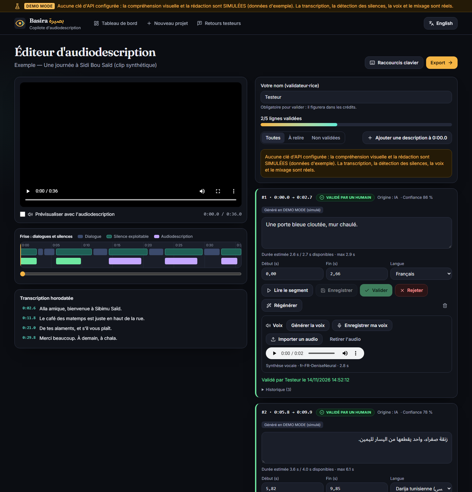

# Wasf <span lang="ar">وصف</span> : copilote d'audiodescription assisté par IA

<p align="center"></p>

Wasf aide à audiodécrire les films tunisiens et francophones. L'IA propose une description dans chaque silence du film, puis un·e audiodescripteur·rice la relit, la corrige et la valide, ligne par ligne.

[](https://github.com/LouaySaidani/hackathonjunior/actions/workflows/ci.yml)
[](LICENSE)


> Projet réalisé pour le hackathon OIF × JEI « IA Éthique 360 ». Wasf (*وصف*) veut dire « description » en arabe. Notre devise : *l'IA décrit, l'humain valide.*

> [!NOTE]
> Prototype de phase 1 : le parcours complet est testé en français ; l'arabe standard et la darija sont disponibles mais encore en test. Voir les [limites](#limites-et-suite).

## Le problème

En Tunisie et dans l'espace francophone, les personnes aveugles et malvoyantes n'ont accès à presque aucun film tunisien ou arabe audiodécrit. L'audiodescription coûte des milliers d'euros par film et n'existe presque pas en arabe. Ces personnes restent donc à l'écart de leur propre patrimoine culturel.

## La solution

Wasf découpe l'audiodescription en étapes. L'IA accélère le travail, mais la décision reste à l'humain :

1. l'IA repère les silences du film et propose un brouillon de description pour chacun, à partir de quelques images clés ;
2. un·e audiodescripteur·rice corrige, recale, régénère, valide ou rejette chaque ligne ;
3. Wasf génère la voix, mixe la bande son et produit les fichiers d'accessibilité ;
4. des relecteur·rice·s aveugles, rémunéré·e·s, évaluent le résultat.

Aucune ligne n'est validée automatiquement, et seules les lignes validées par une personne nommée sont lues à voix haute et exportées.

<p align="center"></p>

<table>
<tr>
<td width="50%" valign="top"></td>
<td width="50%" valign="top"></td>
</tr>
<tr>
<td><b>Analyse</b> : transcription, silences découpés en créneaux, score ML de chaque créneau, puis brouillons rédigés à partir des images clés.</td>
<td><b>Éditeur</b> : chaque brouillon est relu, corrigé, puis validé par une personne nommée.</td>
</tr>
</table>

**Gain de temps mesuré.** Sur un extrait de 63 s (« Les éphémères », Nils Caneele, CC BY-NC), il a fallu 4 min 36 s au total : 58 s d'analyse automatique, 3 min 12 s de relecture humaine, 26 s de voix et de mixage. Une audiodescription professionnelle complète demande environ 1 heure par minute de film (AFP). Notre mesure n'est qu'indicative (une séance, un relecteur non professionnel) et devra être refaite avec des professionnel·le·s.

## Comment ça marche

<p align="center"></p>

1. **Import** de la vidéo, avec consentement obligatoire et, si on le souhaite, la distribution (nom et description visuelle des personnages).
2. **Analyse** : Silero VAD et faster-whisper trouvent la parole ; les silences d'au moins 1,5 s sont découpés en créneaux d'environ 10 s, notés par notre modèle ML, et 1 à 3 images clés sont extraites par créneau.
3. **Brouillons** : Gemini décrit les images clés en tenant compte du dialogue voisin et de la distribution, sans reconnaissance faciale, dans le budget de mots du créneau.
4. **Relecture** dans l'éditeur : modifier, recaler, régénérer, valider ou rejeter.
5. **Export** : voix de synthèse (edge-tts), mixage avec atténuation de la bande originale, puis `film_audiodecrit.mp4`, WebVTT, TTML, crédits et script pour l'ayant droit.

Stack : FastAPI, React + TypeScript, FFmpeg, Silero VAD, faster-whisper, scikit-learn, Gemini, edge-tts, SQLite. Détails : [architecture](docs/architecture.md) · [API](docs/api.md).

## Le modèle ML : où décrire ?

Un·e audiodescripteur·rice ne décrit pas tous les silences. Nous avons entraîné un modèle sur des descriptions écrites par des humains ([QuerYD](https://www.robots.ox.ac.uk/~vgg/data/queryd/), 17 vidéos d'entraînement, 13 de test) pour qu'il apprenne où les placer. Gemini ne rédige que dans les créneaux retenus ; les autres restent disponibles avec un bouton « Rédiger ici ».

| Méthode (13 vidéos de test) | Précision | Rappel | F1 |
|---|---|---|---|
| Décrire tous les créneaux | 61 % | 100 % | 0,76 |
| Modèle ML | 62 % | 96 % | 0,75 |

Le modèle apprend un vrai signal (AP de 0,74 contre 0,61 au hasard), mais avec si peu de données il ne fait pas encore mieux que « tout décrire ». Les données nous ont en revanche appris à découper les longs silences : 91 % des descriptions humaines tombent désormais dans un créneau de Wasf. Détails et rapport : [ml/README.md](ml/README.md).

## Éthique 360

| Angle | Ce que fait Wasf |
|---|---|
| Créateurs et métiers | L'humain valide chaque ligne sous son nom ; les relecteur·rice·s aveugles sont rémunéré·e·s. |
| Droits | Consentement obligatoire à l'import ; aucun entraînement sur les films importés ; script remis à l'ayant droit. |
| Données | Pas de reconnaissance faciale ; seules quelques images clés et le dialogue en texte quittent la machine. |
| Cultures et langues | Français, arabe standard et darija, affichage de droite à gauche ; le choix de la langue revient aux usagers aveugles. |
| Transparence | État visible sur chaque ligne ; mentions IA et validation dans tous les exports. |
| Planète | Seuls les silences sont traités ; Whisper quantifié, sur CPU par défaut. |

Détails, plan de validation et licences : [docs/ethics.md](docs/ethics.md).

## Démarrage rapide

Il faut Git, Python 3.11, Node.js 22 ou plus et FFmpeg. Sous Linux ou macOS :

```bash
git clone https://github.com/LouaySaidani/hackathonjunior.git
cd hackathonjunior
make install && make build
cp .env.example .env      # facultatif : ajoutez GEMINI_API_KEY pour de vraies descriptions
make backend              # puis ouvrez http://localhost:8000
```

Sans clé d'API, Wasf démarre en DEMO MODE avec des descriptions préparées à l'avance, et le signale partout. Pour un premier essai : **Tableau de bord → « Essayer le clip d'exemple » → Lancer l'analyse → Éditeur → Valider → Export.**

Windows, dépannage, configuration et tests : [docs/installation.md](docs/installation.md).

## Limites et suite

- Seul le français est testé de bout en bout. Whisper générique transcrit mal la darija, d'où un fine-tuning prévu sur des corpus tunisiens (LinTO, TunSwitch, TARIC, TEDxTN).
- Les brouillons dépendent de Gemini, dont la version gratuite limite à environ 20 requêtes par jour. En phase 2, nous voulons le remplacer par notre propre modèle de description, capable de tourner en local.
- Le modèle ML n'a vu que 17 vidéos, avec des descriptions en anglais ; il faudra le réentraîner sur plus de données et sur des films tunisiens annotés.
- La voix edge-tts a besoin d'Internet ; hors ligne, Wasf passe à espeak-ng.
- Nous ne donnons aucun chiffre sur le nombre de personnes aveugles en Tunisie, faute de source vérifiée.

## Licences et équipe

Code sous [Apache-2.0](LICENSE). La vidéo d'exemple est un extrait de « Les éphémères » (Nils Caneele, 2013) sous CC BY-NC ([samples/LICENSE.md](samples/LICENSE.md)). Les vidéos QuerYD servent à l'entraînement et ne sont jamais redistribuées. Licences des dépendances : [docs/ethics.md](docs/ethics.md#licences).

Équipe hackathonjunior, hackathon OIF × JEI « IA Éthique 360 ». Merci à l'OIF et à la JEI, aux associations de personnes aveugles et malvoyantes, aux audiodescripteur·rice·s dont le travail a inspiré cet outil, et aux communautés open source de FFmpeg, faster-whisper, Silero, espeak-ng et edge-tts.
