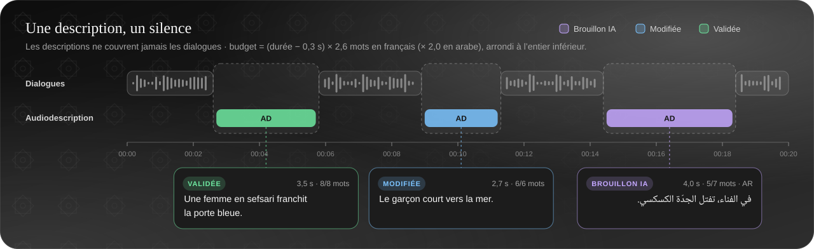
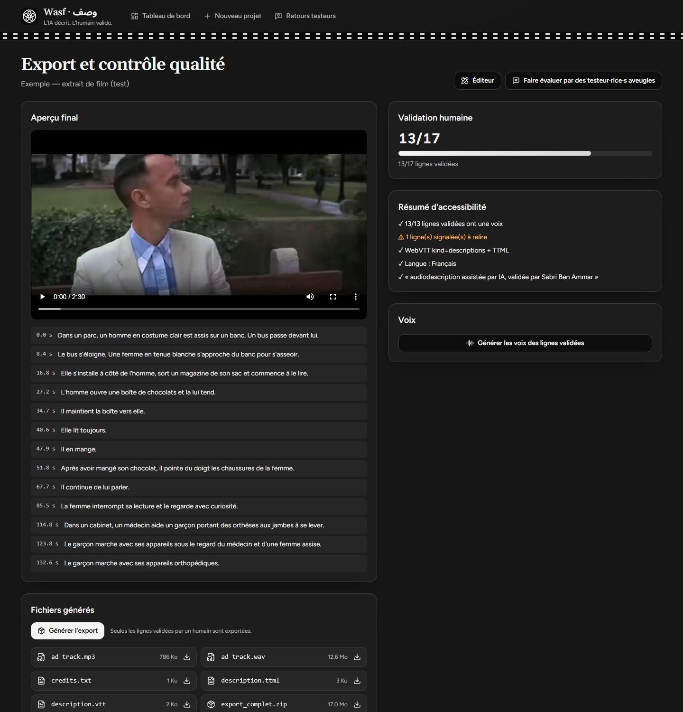
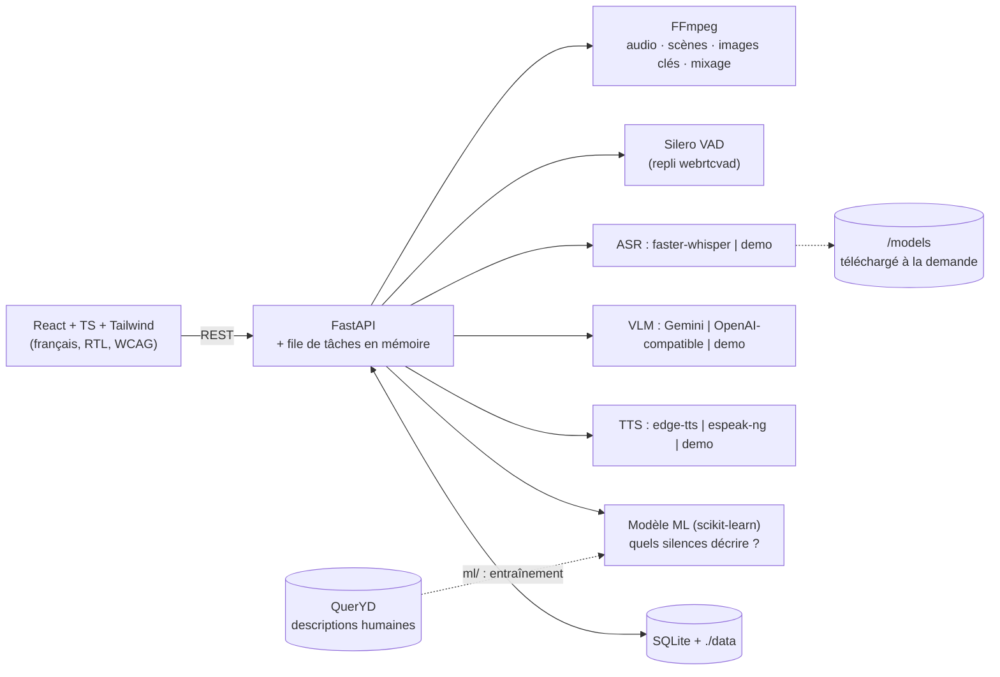

# Wasf <span lang="ar">وصف</span> : copilote d'audiodescription assisté par IA

<p align="center"></p>

Wasf aide à audiodécrire les films tunisiens et francophones. L'IA propose une description dans chaque silence du film, puis un·e audiodescripteur·rice la relit, la corrige et la valide, ligne par ligne.

[](https://github.com/LouaySaidani/hackathonjunior/actions/workflows/ci.yml)
[](LICENSE)


> Projet réalisé pour le hackathon OIF × JEI « IA Éthique 360 ». Wasf (*وصف*) veut dire « description » en arabe. Notre devise : *l'IA décrit, l'humain valide.*

> [!NOTE]
> **Wasf est un prototype de phase 1, pas une version finale.**
>
> Tout le parcours a été développé et testé en français. On peut déjà choisir l'arabe standard ou la darija, mais ces deux langues sont encore en test.
>
> Les brouillons sont écrits pour l'instant par Gemini, un LLM multimodal en ligne de Google. En phase 2, nous voulons entraîner notre propre modèle, pensé pour l'audiodescription et capable de tenir compte du contexte du film.
>
> Notre modèle ML, qui choisit les scènes à décrire, est entraîné et évalué. Avec seulement 17 vidéos d'entraînement, il ne fait pas encore mieux que « tout décrire », et l'humain garde donc toujours la décision.
>
> Pour en savoir plus : [Limites honnêtes](#limites-honnêtes) · [Feuille de route](#feuille-de-route).

**Sommaire** : [Le problème](#le-problème) · [La solution](#la-solution) · [Vocabulaire](#vocabulaire) · [Installation et lancement](#installation-et-lancement) · [Utilisation](#utilisation) · [Architecture](#architecture) · [Le pipeline en 7 étapes](#le-pipeline-en-7-étapes) · [Apprentissage automatique](#apprentissage-automatique--où-décrire-) · [Éthique 360](#éthique-360) · [Fonctionnalités](#fonctionnalités-implémentées) · [Configuration](#configuration) · [Développement et tests](#développement) · [Feuille de route](#feuille-de-route) · [Limites honnêtes](#limites-honnêtes) · [Licences](#licences-des-données-et-des-modèles)

---

## Le problème

En Tunisie et dans l'espace francophone, les personnes aveugles et malvoyantes n'ont accès à presque aucun film tunisien ou arabe audiodécrit. L'audiodescription coûte des milliers d'euros par film et n'existe presque pas en arabe. Ces personnes restent donc à l'écart de leur propre patrimoine culturel.

## La solution

Wasf découpe l'audiodescription en étapes. L'IA accélère certaines d'entre elles, mais la décision reste à l'humain :

1. l'IA repère les silences du film et propose un brouillon de description pour chacun, à partir de quelques images clés ;
2. un·e audiodescripteur·rice corrige, recale, régénère, valide ou rejette chaque ligne ;
3. la plateforme génère la voix, mixe la bande son et produit les fichiers d'accessibilité ;
4. des relecteur·rice·s aveugles, rémunéré·e·s, évaluent le résultat.

Aucune ligne n'est validée automatiquement : une ligne écrite par l'IA reste étiquetée comme telle tant qu'une personne nommée ne l'a pas validée.

Voici le temps mesuré sur la vidéo d'exemple (63 s de film), d'après l'historique horodaté de chaque ligne, le 15/11/2026 :

| Étape | Durée |
|---|---|
| Analyse automatique : silences, transcription, tri ML, 6 brouillons | 58 s |
| Relecture humaine : 6 lignes, 4 validées, 2 rejetées (la 2ᵉ lors d'une seconde relecture de quelques secondes, non comptée) | 3 min 12 s |
| Voix de synthèse et mixage | 26 s |
| **Total** | **4 min 36 s** |

À titre de repère, une audiodescription professionnelle complète demande environ 1 heure de travail par minute de film (AFP). Notre mesure ne donne qu'un ordre d'idée : une seule séance, un relecteur non professionnel, un extrait court, et sans compter le temps de visionnage avant la première décision. Il faudra la refaire avec des audiodescripteur·rice·s professionnel·le·s.

<p align="center"></p>

<table>
<tr>
<td width="50%" valign="top"></td>
<td width="50%" valign="top"></td>
</tr>
<tr>
<td><b>Analyse</b> : Whisper transcrit les dialogues, Wasf trouve les silences et les découpe en créneaux, le modèle ML donne à chaque créneau un score de pertinence, puis Gemini rédige à partir des images clés.</td>
<td><b>Éditeur</b> : chaque brouillon est relu, corrigé et recalé, puis validé par une personne nommée. Seules les lignes validées reçoivent une voix et entrent dans le mixage.</td>
</tr>
</table>

<sub>Captures réelles sur la vidéo d'exemple, un extrait de 63 s du court métrage francophone « Les éphémères » (Nils Caneele, 2013, CC BY-NC : voir <code>samples/LICENSE.md</code>) : 6 brouillons rédigés par <code>gemini-3.6-flash</code>, relus dans l'éditeur ; lignes validées, rejetée, corrigée ou encore à relire, vocalisées avec <code>fr-FR-DeniseNeural</code>.</sub>

<details>
<summary>Autres écrans : tableau de bord, export</summary>




</details>

## Vocabulaire

| Terme | Sens dans Wasf |
|---|---|
| **Audiodescription (AD)** | Voix qui décrit ce qui se passe à l'image, placée entre les dialogues, pour les personnes aveugles et malvoyantes |
| **Silence** | Passage du film sans dialogue d'au moins 1,5 s, détecté automatiquement |
| **Créneau** | Partie d'un silence où une ligne d'AD peut être placée ; les longs silences sont découpés en créneaux d'environ 10 s |
| **Score de pertinence** | Note donnée à chaque créneau par notre modèle ML : faut-il y décrire quelque chose ? |
| **Brouillon IA** | Ligne proposée par le modèle de vision (Gemini), qui reste muette tant qu'un humain ne l'a pas validée |
| **Budget de mots** | Nombre maximal de mots qui tiennent dans un créneau, selon la langue |
| **VAD / ASR / VLM / TTS** | Détection de la parole / transcription / modèle de vision et de langage / synthèse vocale |
| **DEMO MODE** | Fonctionnement sans clé d'API : les descriptions sont simulées et signalées comme telles partout |

## Installation et lancement

Wasf tourne sur votre propre ordinateur. La première installation prend 15 à 20 minutes et demande une connexion Internet.

### 1. Installer les outils (une seule fois)

| Outil | Version | Rôle | Vérification |
|---|---|---|---|
| **Git** | récente | récupérer le code | `git --version` |
| **Python** | **3.11** | serveur et pipeline d'IA | `py -3.11 --version` (Windows) ou `python3.11 --version` |
| **Node.js** | **22 ou plus** | construire l'interface web | `node --version` |
| **FFmpeg** | récente | audio, images clés, mixage | `ffmpeg -version` |
| espeak-ng | *facultatif* | voix de secours sans Internet | `espeak-ng --version` |

**Windows** (PowerShell) :

```powershell
winget install -e --id Git.Git
winget install -e --id Python.Python.3.11
winget install -e --id OpenJS.NodeJS.LTS
winget install -e --id Gyan.FFmpeg
```

Fermez puis rouvrez PowerShell pour qu'il trouve les nouveaux outils, et vérifiez-les avec les commandes de la dernière colonne.

Sous Linux ou macOS, suivez plutôt l'[installation rapide sous Linux et macOS](#installation-rapide-sous-linux-et-macos), plus bas : elle remplace les étapes 1 à 6.

### 2. Récupérer le code

```powershell
git clone https://github.com/LouaySaidani/hackathonjunior.git
cd hackathonjunior
```

> Le dépôt est privé : il faut avoir été invité sur GitHub.

### 3. Installer les dépendances Python

```powershell
py -3.11 -m venv .venv                                       # Linux/macOS : python3.11 -m venv .venv
.venv\Scripts\python -m pip install --upgrade pip              # Linux/macOS : .venv/bin/python …
.venv\Scripts\python -m pip install -r backend\requirements.txt
```

### 4. Construire l'interface web

```powershell
cd frontend
npm ci
npm run build
cd ..
```

> Un avertissement `npm warn install-scripts … esbuild` peut s'afficher : il est sans conséquence.

### 5. Configurer (facultatif)

```powershell
copy .env.example .env                                       # Linux/macOS : cp .env.example .env
```

Sans clé, Wasf démarre en DEMO MODE, et une bannière le signale. La vidéo d'exemple reçoit alors des descriptions préparées à l'avance et relues par un humain. Pour obtenir de vraies descriptions, ouvrez `.env` et renseignez `GEMINI_API_KEY` (une [clé gratuite sur Google AI Studio](https://aistudio.google.com/apikey) suffit).

> La version gratuite de Gemini permet environ 20 requêtes par jour et par modèle. Wasf décrit 8 créneaux par requête, si bien qu'un extrait de 2 minutes coûte 2 requêtes. Quand le quota est épuisé, il passe tout seul à un modèle « lite ».

### 6. Lancer Wasf

```powershell
cd backend
..\.venv\Scripts\python -m uvicorn app.main:app --port 8000      # Linux/macOS : ../.venv/bin/python -m uvicorn …
```

Ouvrez <http://localhost:8000>. `Ctrl+C` dans le terminal arrête le serveur ; pour le relancer plus tard, il suffit de refaire l'étape 6.

### 7. Premier essai

**Tableau de bord → « Essayer le clip d'exemple » → Lancer l'analyse → Éditeur → Valider → Export.**

> À la première analyse, le modèle Whisper `small` (~460 Mo) est téléchargé une seule fois dans `models/`.

### Installation rapide sous Linux et macOS

Ce sont les mêmes étapes, raccourcies grâce au `Makefile` du dépôt :

```bash
# 1. Outils
#    Debian 12 / Ubuntu 22.04 : sudo apt install git python3.11 python3.11-venv ffmpeg espeak-ng
#    Ubuntu 24.04 (pas de Python 3.11 par défaut) : sudo add-apt-repository ppa:deadsnakes/ppa, puis la ligne ci-dessus
#    macOS (Homebrew) : brew install git python@3.11 node ffmpeg espeak-ng
#    Node.js 22 : le paquet apt « nodejs » est trop ancien, passez par https://nodejs.org ou nvm (nvm install 22)

# 2. Code
git clone https://github.com/LouaySaidani/hackathonjunior.git
cd hackathonjunior

# 3 et 4. Dépendances Python (dans .venv) et interface web
make install
make build

# 5. Configuration (facultatif, voir l'étape 5 ci-dessus)
cp .env.example .env

# 6. Lancement, puis ouvrez http://localhost:8000
make backend
```

Vérifiez les versions avec `python3.11 --version`, `node --version` (22 ou plus) et `ffmpeg -version`.

### En cas de problème

| Message | Solution |
|---|---|
| `ffmpeg` ou `node` n'est pas reconnu | fermez et rouvrez le terminal après l'installation (étape 1) |
| « Frontend non construit » | refaites l'étape 4 |
| le port 8000 est déjà utilisé | lancez avec `--port 8001` et ouvrez <http://localhost:8001> |
| voix remplacée par un bip | pas d'Internet pour la voix edge-tts : installez espeak-ng (voix de secours) |
| `npm ci` échoue ou Vite refuse de démarrer | Node.js trop ancien : installez la version 22 ou plus |
| `python3.11: command not found` (Linux) | Python 3.11 n'est pas installé : voir l'[installation rapide](#installation-rapide-sous-linux-et-macos) |

## Utilisation

### Parcours complet : de la vidéo au film audiodécrit

1. **Nouveau projet** : importez la vidéo, cochez le consentement, choisissez la langue de description.
2. **Analyse → Lancer l'analyse** : silences, créneaux, scores ML et brouillons Gemini (de 30 s à 2 min).
3. **Éditeur** : indiquez votre nom, relisez chaque ligne et cliquez sur Valider. Au clavier, J et K passent d'une ligne à l'autre, V valide et X rejette. Une fois la relecture faite, « Tout valider » traite le reste d'un coup. Un brouillon non validé ne sera jamais lu à voix haute.
4. **Export → Générer les voix des lignes validées → Générer l'export**, puis téléchargez `film_audiodecrit.mp4`.

### Vidéos pour tester

```bash
bash scripts/get_test_videos.sh     # 4 extraits de films libres de la Blender Foundation (CC-BY) dans videos_test/
```

| Vidéo | Durée | Intérêt |
|---|---|---|
| `05_sintel_bande_annonce.mp4` | 52 s | premier essai, environ 1 requête Gemini |
| `04_caminandes_llama_drama.mp4` | 1 min 30 | animation comique sans dialogue |
| `01_tears_of_steel_dialogue.mp4` | 2 min 30 | prises de vue réelles, dialogues et silences (celle des captures) |
| `03_spring_sans_dialogue.mp4` | 2 min 30 | aucun dialogue : découpage en créneaux de 10 s |

Ces vidéos sont sous licence CC-BY : vous pouvez les montrer en public en citant l'œuvre et la Blender Foundation (les crédits sont dans `videos_test/CREDITS.md`). Pour comparer avec de vraies audiodescriptions humaines, prenez plutôt les 13 vidéos de test QuerYD que télécharge `python ml/run_all.py` (voir [ml/README.md](ml/README.md)).

## Architecture

<p align="center"></p>



Détails : [docs/architecture.md](docs/architecture.md) · API : [docs/api.md](docs/api.md) (et `/docs` en direct).

## Le pipeline en 7 étapes

| # | Étape | Ce qui se passe | Technologie |
|---|---|---|---|
| 1 | **Import** | MP4/MOV/MKV, contrôle du format et de la taille, aperçu et métadonnées, consentement obligatoire, distribution facultative (nom et description visuelle) | FastAPI, ffprobe |
| 2 | **Analyse** | Extraction de l'audio en 16 kHz, détection de la parole, transcription horodatée, silences d'au moins 1,5 s (avec une marge de 0,25 s), changements de plan, découpage des longs silences en créneaux d'environ 10 s (aux changements de plan), score de pertinence ML de chaque créneau, 1 à 3 images clés par créneau | FFmpeg, Silero VAD, faster-whisper, scikit-learn |
| 3 | **Compréhension visuelle** | Le VLM reçoit les images clés, le dialogue autour et la distribution. Il ne fait aucune reconnaissance faciale et a pour consigne de ne rien inventer ; quand il hésite, la ligne est marquée « À relire » | Gemini / OpenAI-compatible / demo |
| 4 | **Brouillons** | Description concise qui ne répète pas le dialogue, raccourcie ou signalée si elle dépasse la durée du silence (estimation en mots par seconde selon la langue) | `fit_to_gap` |
| 5 | **Éditeur humain** | Lecture, frise, transcription, modification du texte et du minutage, ajout manuel, suppression, régénération avec consigne, validation et rejet (ligne par ligne, ou « Tout valider » après relecture), raccourcis clavier. États : `BROUILLON IA` → `MODIFIÉ PAR UN HUMAIN` → `VALIDÉ PAR UN HUMAIN` (nom et date) | React |
| 6 | **Voix** | Synthèse vocale des lignes validées uniquement. La voix est toujours générée ; l'humain, lui, travaille sur le texte. Si besoin, la voix est un peu accélérée ou coupée pour ne jamais empiéter sur le dialogue | edge-tts, espeak-ng |
| 7 | **Mixage et export** | Atténuation de la bande originale pendant les descriptions. Fichiers produits : `film_audiodecrit.mp4` (piste AD mixée + piste originale), `ad_track.mp3/.wav`, `description.vtt` (kind=descriptions), `description.ttml`, `credits.txt`, `script_ayant_droit.json`, `.zip` | FFmpeg |

La page « Retours testeurs » complète le tout. Les testeur·rice·s y notent leur compréhension de 1 à 5, indiquent s'ils préfèrent l'arabe standard, la darija ou le français, et peuvent laisser un commentaire ; la page en fait la synthèse.

## Apprentissage automatique : où décrire ?

Un·e audiodescripteur·rice ne décrit pas tous les silences, et découpe un long passage muet en plusieurs descriptions. Nous avons entraîné un modèle sur des descriptions écrites par des humains pour qu'il apprenne où les placer.

| | Rôle | Entraîné par nous ? |
|---|---|---|
| VAD + Whisper | trouver les silences | non |
| **Modèle ML** ([`ml/`](ml/)) | choisir les créneaux à décrire | **oui** |
| Gemini | écrire ce qui se passe à l'image | non (pré-entraîné) |
| edge-tts + FFmpeg | voix et mixage | non |

**Données.** Nous utilisons [QuerYD](https://www.robots.ox.ac.uk/~vgg/data/queryd/) (Oxford, ICASSP 2021), un ensemble de vidéos YouTube audiodécrites par les bénévoles de [YouDescribe](https://youdescribe.org), avec l'horodatage et le type de chaque description. Nous n'en gardons que les horaires, le type et le texte des descriptions ; les noms et e-mails des bénévoles sont supprimés. Sur 30 vidéos (films, courts métrages d'animation, extraits), 17 servent à l'entraînement et 13 au test, sans qu'aucune vidéo ne figure dans les deux.

**Méthode.** Chaque vidéo passe par le pipeline de Wasf lui-même, qui calcule 24 variables par créneau : durée, dialogue autour, changements de plan, mouvement, luminosité, niveau sonore, musique. Un créneau est étiqueté 1 si un humain y a commencé une description. Nous comparons trois modèles (régression logistique, forêt aléatoire, gradient boosting) en validation croisée par vidéo, et le seuil de décision est choisi sur les données d'entraînement seulement.

**Ce que les données nous ont appris.** Notre première version ne proposait qu'un brouillon par silence, même pour 150 s sans dialogue, alors que les humains décrivent à peu près toutes les 10 à 25 s. Wasf découpe donc maintenant les longs silences en créneaux d'environ 10 s, aux changements de plan. Avec ce découpage, 91 % des descriptions humaines (407 sur 448) commencent dans un créneau où Wasf peut rédiger.

**Résultats sur les 13 vidéos de test** (276 créneaux, [rapport complet](ml/reports/report.md)) :

| Méthode | Précision | Rappel | F1 | Créneaux rédigés |
|---|---|---|---|---|
| Tous les créneaux (sans ML) | 61 % | 100 % | 0,76 | 100 % |
| Règle de durée (≥ 3 s) | 65 % | 95 % | 0,77 | 89 % |
| Modèle ML (régression logistique) | 62 % | 96 % | 0,75 | 95 % |

<p align="center"></p>

**Comment lire ces chiffres.** Le modèle a bien appris quelque chose : sa précision moyenne (AP) est de 0,74, contre 0,61 au hasard (IC 95 % : 0,67 à 0,81). Il s'appuie surtout sur la durée du créneau, le niveau sonore (musique, bruitages), le fait d'être le premier créneau de la vidéo et les changements de luminosité. Avec 17 vidéos d'entraînement, il ne fait pourtant pas mieux que « décrire tous les créneaux », car les humains en décrivent déjà 61 %. Dans l'application, il garde donc 95 % des créneaux. La prochaine étape est de l'entraîner sur plus de vidéos (`--train 80 --test 20`, sans toucher au code) et sur des films tunisiens annotés.

**Dans l'application.** Chaque créneau affiche son score de pertinence, et Gemini ne rédige que dans les créneaux retenus. Les autres apparaissent en pointillés avec un bouton « Rédiger ici », pour que l'audiodescripteur·rice puisse passer outre le choix du modèle.

```bash
pip install -r ml/requirements.txt
python ml/run_all.py --train 17 --test 13   # télécharge, analyse, entraîne, évalue (15 à 30 min sur CPU)
```

Les variables, les vidéos de test et tous les détails sont dans [ml/README.md](ml/README.md).

## Éthique 360

| Angle | Notre réponse de conception |
|---|---|
| **Créateurs et métiers** | L'audiodescripteur·rice reste l'auteur·e : chaque ligne est validée explicitement, sous son nom, jamais automatiquement. Seules les lignes validées reçoivent une voix et sont exportées. Les relecteur·rice·s aveugles sont rémunéré·e·s et associé·e·s à l'évaluation (modèle ATAA). |
| **Droits** | La case de consentement est obligatoire, et le serveur refuse l'import sans elle. Les films importés ne servent jamais à l'entraînement ; l'opt-in est désactivé par défaut. L'ayant droit reçoit le script complet (`script_ayant_droit.json`). Le clip de test synthétique est sous CC0, et la vidéo d'exemple est un court métrage francophone sous licence libre (CC BY-NC), crédité. |
| **Données** | Aucune reconnaissance faciale : les personnages ne sont nommés qu'à partir de la distribution fournie. Les données restent en local et les secrets côté serveur. Le VLM (Gemini, service en ligne) ne reçoit que quelques images clés et le dialogue voisin en texte, jamais l'audio ni le film entier. Le texte des lignes validées part vers le service vocal de Microsoft (edge-tts) ; espeak-ng permet de rester hors ligne. Nous avons recensé des jeux de données ouverts de parole tunisienne pour le fine-tuning (LinTO, TunSwitch, TARIC, TEDxTN). |
| **Cultures et langues** | Français, arabe standard et darija tunisienne ; en phase 1, seul le français est testé, l'arabe et la darija sont en cours de test. Le texte s'affiche de droite à gauche dans l'interface, le VTT et le TTML. Un terme culturel précis n'est employé que si l'objet est visible à l'image. Ce sont les usagers aveugles qui tranchent entre arabe standard et darija, et leur préférence est mesurée. |
| **Transparence** | Chaque ligne affiche son état avec une icône et un texte, jamais par la seule couleur. La confiance, la mention « À relire », l'historique et le texte IA d'origine restent visibles. Le VTT, le TTML, les métadonnées MP4 et `credits.txt` indiquent l'usage de l'IA et qui a validé. La mention DEMO MODE suit le projet jusque dans les exports. |
| **Planète** | Seuls les silences et quelques images clés passent par les modèles. Whisper `small` est quantifié en int8 et tourne sur CPU par défaut ; les modèles ne sont téléchargés qu'une fois. |
| **Limites honnêtes** | Voir plus bas. Nous n'avançons aucun chiffre sans source, en particulier sur le nombre de personnes aveugles en Tunisie. |

Détails : [docs/ethics.md](docs/ethics.md) · Plan de validation : [docs/validation-plan.md](docs/validation-plan.md).

## Fonctionnalités implémentées

- ✅ Import MP4/MOV/MKV avec validation, aperçu, métadonnées, consentement, distribution, opt-in désactivé par défaut
- ✅ Extraction audio, VAD Silero réel (repli webrtcvad), transcription faster-whisper réelle (modèle configurable, fine-tune Hugging Face possible)
- ✅ Calcul des silences, détection des changements de plan, découpage des longs silences en créneaux d'environ 10 s, 1 à 3 images clés par créneau
- ✅ Modèle ML entraîné sur des descriptions humaines (QuerYD) : score de pertinence par créneau, sélection des créneaux à rédiger, bouton « Rédiger ici », processus complet dans [`ml/`](ml/) (données, variables, entraînement, évaluation, rapport)
- ✅ Brouillons VLM (Gemini, OpenAI-compatible, demo), ajustés à la durée, signalés en cas de faible confiance, nouvelles tentatives automatiques si Gemini est surchargé
- ✅ Éditeur : modifier, recaler (refus serveur si chevauchement avec un dialogue), ajouter, supprimer, régénérer avec consigne, valider (nom obligatoire), tout valider en une fois (nom obligatoire, lignes trop longues exclues), rejeter, rouvrir, historique, filtres, aperçu avec l'AD, raccourcis J/K/V/X/P/Alt+S/?
- ✅ Synthèse vocale réelle avec edge-tts (`fr-FR-DeniseNeural`, `ar-TN-ReemNeural`), espeak-ng hors ligne, bip de démonstration signalé
- ✅ Mixage avec atténuation de la bande originale, MP4 à 2 pistes, export AD MP3/WAV, WebVTT, TTML, crédits, script pour l'ayant droit, ZIP
- ✅ Tableau de bord, historique des projets, statistiques, suivi de progression des tâches (live regions ARIA)
- ✅ Page de retours des testeurs aveugles, avec synthèse
- ✅ Interface en français, textes arabes affichés de droite à gauche (RTL)
- ✅ Accessibilité : HTML sémantique, lien d'évitement, focus visible, contrastes AA, Lighthouse a11y = 100 sur les 6 pages
- ✅ CI GitHub Actions : lint, tests, notebook et construction de l'interface

## Configuration

Toutes les variables sont documentées dans [`.env.example`](.env.example).

| Variable | Défaut | Rôle |
|---|---|---|
| `ASR_PROVIDER` | `auto` | `whisper` · `demo` · `auto` (whisper, repli demo signalé) |
| `WHISPER_MODEL` | `small` | Taille faster-whisper **ou identifiant HF** d'un modèle CTranslate2 (ex. fine-tune tunisien) |
| `WHISPER_DEVICE` / `WHISPER_COMPUTE_TYPE` | `cpu` / `int8` | `cuda` / `float16` sur carte graphique NVIDIA |
| `VLM_PROVIDER` | `auto` | `gemini` · `openai` · `demo` · `auto` (selon les clés présentes) |
| `GEMINI_API_KEY`, `GEMINI_MODEL` | — / `gemini-3.6-flash` | Fournisseur Gemini |
| `GEMINI_FALLBACK_MODELS` / `VLM_BATCH_SIZE` | `gemini-3.5-flash-lite,gemini-flash-lite-latest` / `8` | Modèles de secours quand le quota du jour est épuisé ; créneaux décrits par requête |
| `OPENAI_API_KEY`, `OPENAI_BASE_URL`, `OPENAI_MODEL` | — / OpenAI / `gpt-4o-mini` | Tout serveur compatible OpenAI |
| `TTS_PROVIDER` | `auto` | `edge` → `espeak` → `demo` |
| `TTS_VOICE_FR` / `_AR` | Denise / Reem (ar-TN) | Voix |
| `VAD_ENGINE` | `silero` | `silero` · `webrtc` |
| `MIN_GAP_SECONDS` / `GAP_PADDING_SECONDS` | `1.5` / `0.25` | Silences exploitables |
| `MAX_SLOT_SECONDS` | `10` | Longueur maximale d'un créneau (les longs silences sont découpés) ; `0` = pas de découpage |
| `CONFIDENCE_THRESHOLD` | `0.6` | En dessous : « À relire » |
| `DUCK_VOLUME` | `0.25` | Niveau de la bande originale pendant l'AD |
| `GAP_SELECTION` | `auto` | `auto` (modèle ML s'il est entraîné, sinon tous les silences) · `model` · `all` |
| `GAP_SCORE_THRESHOLD` / `GAP_MODEL_PATH` | `0` (seuil appris) / `ml/artifacts/gap_scorer.joblib` | Sélection ML des silences |
| `MAX_UPLOAD_MB`, `SEED_SAMPLE`, `DATA_DIR`, `MODELS_DIR` | `500`, `true`, `./data`, `./models` | Stockage |
| `SAMPLE_VIDEO` / `SAMPLE_TITLE` | `samples/les_ephemeres.mp4` / « Exemple — Les éphémères (extrait, CC BY-NC) » | Vidéo du projet d'exemple. Une vidéo locale peut aller dans `samples/local/` (ignoré par git). En DEMO MODE, une transcription et un script de référence sont utilisés s'ils sont fournis à côté de la vidéo (`<nom>.transcript.json`, `<nom>.script.json`) |

## Développement

Après l'installation ci-dessus :

```powershell
.venv\Scripts\python -m pip install -r backend\requirements-dev.txt     # outils de test et de lint
cd backend
..\.venv\Scripts\python -m uvicorn app.main:app --reload --port 8000    # rechargement automatique du serveur
```

Pour modifier l'interface avec rechargement à chaud : `cd frontend` puis `npm run dev`, et ouvrez <http://localhost:5173> (les appels `/api` sont relayés vers le port 8000).

## Tests

```powershell
cd backend
..\.venv\Scripts\python -m pytest -q     # 49 tests : silences/VAD réel, créneaux, ajustement, VTT/TTML/crédits, fournisseurs (HTTP simulé), quota Gemini, sélection ML, parcours API complet, migrations
..\.venv\Scripts\ruff check .            # lint
cd ..\frontend
npm run build
```

- Le notebook [`notebooks/pipeline_demo.ipynb`](notebooks/pipeline_demo.ipynb) exécute le pipeline de bout en bout en DEMO MODE (vérifié en CI).
- Audit d'accessibilité Lighthouse : 100/100 sur le tableau de bord, le nouveau projet, l'analyse, l'éditeur, l'export et les retours.

## Feuille de route

- Phase 2 : entraîner notre propre modèle de description, qui tienne compte du contexte du film (scènes précédentes, personnages, dialogue). Il remplacera Gemini et pourra tourner en local.
- Mieux choisir les scènes à décrire : réentraîner le modèle ML sur plus de vidéos (`--train 80 --test 20`) et sur des films francophones et tunisiens annotés, puis ordonner la relecture selon le score.
- Finir de tester l'arabe standard et la darija avec des locuteur·rice·s natif·ve·s et des usagers aveugles.
- Adapter Whisper à la darija (fine-tuning sur LinTO, TunSwitch, TARIC et TEDxTN, selon leurs licences), le convertir en CTranslate2 et le brancher via `WHISPER_MODEL`.
- Garder les personnages cohérents d'une scène à l'autre, toujours sans reconnaissance faciale, à partir de la distribution (vêtements, position).
- Permettre l'édition à plusieurs : plusieurs audiodescripteur·rice·s, relecture croisée, commentaires.
- Ajouter un tableau de bord des retours des testeurs, par langue, par extrait et dans le temps.
- Plus tard : profils TTML pour la diffusion (EBU-TT-D, IMSC), Piper TTS hors ligne, stockage objet, déploiement cloud.

## Limites honnêtes

Wasf est un prototype de hackathon et tout n'est pas terminé. Cette section dit ce qui marche, ce qui reste à tester et ce qui sera remplacé.

**Ce qui a tourné pour de vrai pendant le hackathon** : FFmpeg, Silero VAD, faster-whisper `small` sur CPU, Gemini, edge-tts (français et ar-TN), le mixage, les exports, ainsi que l'entraînement et l'évaluation du modèle ML sur 30 vidéos.

**Langues.** Wasf a été développé et testé en français. L'arabe standard et la darija sont déjà proposés (brouillons, voix `ar-TN`, affichage de droite à gauche), mais restent en test. Whisper générique transcrit mal la darija et l'alternance arabe/français, et la voix `ar-TN` lit la darija de façon approximative ; l'interface le signale à l'audiodescripteur·rice. C'est pour cela que nous prévoyons un fine-tuning.

**Gemini.** En phase 1, les brouillons viennent d'un LLM en ligne de Google, qui reçoit quelques images clés et le dialogue voisin. Nous l'avons testé avec une vraie clé. La version gratuite n'autorise qu'environ 20 requêtes par jour et par modèle : Wasf décrit donc 8 créneaux par requête (2 requêtes pour un extrait de 2 minutes) et passe à un modèle « lite » quand le quota du jour est épuisé. Si tous les quotas sont épuisés, l'analyse se termine avec les brouillons déjà écrits, et les créneaux restants se rédigent plus tard avec « Rédiger ici » ou à la main. Notre propre modèle de description doit remplacer Gemini (voir la feuille de route). L'intégration OpenAI-compatible, elle, n'a été testée qu'avec des réponses HTTP simulées.

**DEMO MODE.** Sans clé d'API, la compréhension visuelle est simulée. Pour une vidéo accompagnée d'un script de référence (la vidéo d'exemple `samples/les_ephemeres.mp4` et le clip de test synthétique), Wasf renvoie ce script, relu par un humain ; `scripts/export_reference.py` le produit à partir d'un projet validé. Pour toute autre vidéo, il écrit une ligne générique à partir des couleurs réelles de l'image, avec une confiance faible. La bannière et les exports le signalent.

**Modèle ML.** Il a été entraîné sur 17 vidéos seulement, avec des descriptions bénévoles en anglais. Il apprend *où* décrire, pas *quoi* ni dans quelle langue, et ne bat pas encore la règle « tout décrire » (voir [les résultats](#apprentissage-automatique--où-décrire-)). Rien ne garantit encore qu'il se transpose aux films tunisiens.

**Autres limites techniques.**
- edge-tts a besoin d'Internet. Hors ligne, l'application passe à espeak-ng (voix robotique), puis à un bip, et le signale.
- La détection de scène par score FFmpeg rate parfois les fondus progressifs ; une image clé est de toute façon extraite au milieu de chaque silence.
- Le débit de parole est estimé en mots par seconde. C'est une approximation : la durée réelle de l'audio est vérifiée au moment de générer la voix.
- La file de tâches vit en mémoire : une tâche interrompue par un redémarrage est marquée en erreur et doit être relancée.

**Modèle économique.** En Tunisie, aucune loi n'oblige qui que ce soit à financer l'audiodescription. Les pistes sont les festivals (JCC…), la télévision publique (Al Wataniya), les subventions de l'OIF, de l'UE ou d'ambassades, et le mécénat. Wasf cherche à baisser le coût par film, sans remplacer le métier d'audiodescripteur·rice.

Enfin, nous ne donnons aucune statistique sur le nombre de personnes aveugles en Tunisie, faute de source vérifiée.

## Licences des données et des modèles

| Élément | Licence |
|---|---|
| Code de Wasf | Apache-2.0 ([LICENSE](LICENSE)) |
| Vidéo d'exemple `samples/les_ephemeres.mp4` et son script de référence | Extrait de « Les éphémères », Nils Caneele (2013), **CC BY-NC** : usage non commercial, attribution obligatoire ([samples/LICENSE.md](samples/LICENSE.md)) |
| Clip de test synthétique, transcription et script de référence | CC0 1.0 ([backend/tests/fixtures/LICENSE.md](backend/tests/fixtures/LICENSE.md)) |
| faster-whisper / CTranslate2 | MIT ; poids Whisper d'OpenAI sous MIT |
| Silero VAD | MIT |
| scikit-learn | BSD-3-Clause |
| QuerYD / YouDescribe (horaires et textes des descriptions, pour l'entraînement) | Données de recherche ; vidéos YouTube téléchargées localement par `ml/download.py`, **jamais redistribuées** (`ml/data/` est exclu du dépôt) |
| FFmpeg | LGPL/GPL (binaire système, non redistribué dans le dépôt) |
| espeak-ng | GPL-3.0 (installé séparément, facultatif) |
| edge-tts | Bibliothèque sous LGPL-3.0 ; service vocal de Microsoft soumis à ses conditions |
| Gemini / modèles OpenAI-compatibles | Conditions de chaque fournisseur ; non utilisés en DEMO MODE |
| LinTO, TunSwitch, TARIC, TEDxTN (prévus pour le fine-tuning, non inclus) | Voir la licence de chaque jeu de données à sa source |

## Équipe

Équipe **hackathonjunior**, hackathon OIF × JEI « IA Éthique 360 ».

## Remerciements

Merci à l'Organisation internationale de la Francophonie et à la JEI d'avoir organisé le hackathon, aux associations de personnes aveugles et malvoyantes et aux audiodescripteur·rice·s, dont le travail a inspiré cet outil, et aux communautés open source de FFmpeg, faster-whisper, Silero, espeak-ng et edge-tts.
