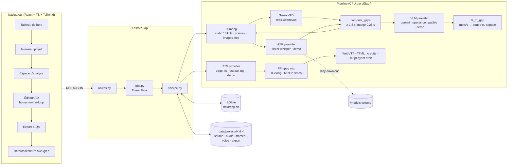
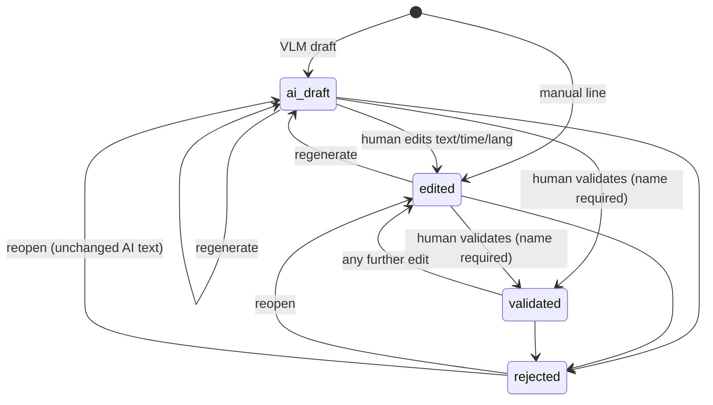

# Architecture

Wasf is a single container: a FastAPI backend that serves a React single-page app, runs AI/media jobs in an
in-process thread pool, and stores everything in SQLite + local files under `./data`.

## Key design decisions

| Decision | Why |
|---|---|
| **VAD is authoritative for timing**, ASR segments only fill VAD misses | Whisper segment boundaries often span silences; trusting them erased all gaps on the sample. VAD timing + a 0.25 s safety margin guarantees descriptions never overlap speech. |
| **Only gaps + 1–3 keyframes per gap** reach the VLM | A 90-min film has ~130 000 frames; we send a few hundred. Lower cost, lower energy, less data sent to third parties. |
| **Providers behind tiny interfaces** (`providers/asr.py`, `vision.py`, `tts.py`) | Swap Whisper for a Tunisian fine-tune, Gemini for a local VLM via an OpenAI-compatible server, edge-tts for Piper, by env var only. |
| **Validation is a separate, explicit API call with a name** (`POST /descriptions/{id}/validate`) | No code path sets `validated` automatically. Any edit after validation resets the line to `edited`. |
| **Export only includes human-validated lines** | Nothing reaches the audience without human sign-off. |
| **In-process job queue** | No Redis needed for an MVP; jobs interrupted by a restart are marked failed at boot. |
| **Server-side interval check** | `PATCH`/`POST` descriptions refuse intervals overlapping detected speech (HTTP 422). |
| **DEMO MODE flags propagate** | `demo` flag on each line, banner in UI, `NOTE` in VTT, `ttm:desc` in TTML, MP4 `comment` metadata, `credits.txt`. |

## Data model (SQLite)

`Project` · `TranscriptSegment` · `SpeechRegion` · `Gap` · `Keyframe` · `Description` (status, origin, flags,
confidence, provider/model, original AI text, validator + timestamp, JSON history, audio) · `Job` · `Feedback`.

Files live in `data/projects/<id>/`: `source.*`, `audio.wav`, `frames/*.jpg`, `voice/*.wav`, `export/*`.
Paths are stored relative to `DATA_DIR`, so moving to object storage only requires changing `service.absolute/rel`.

## Description lifecycle

