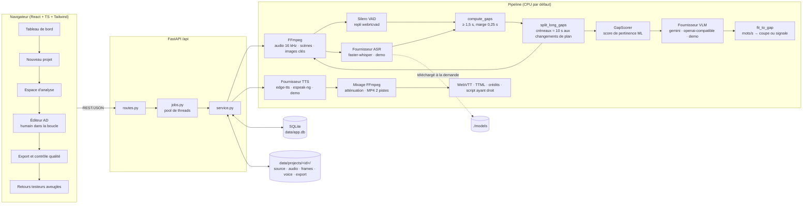
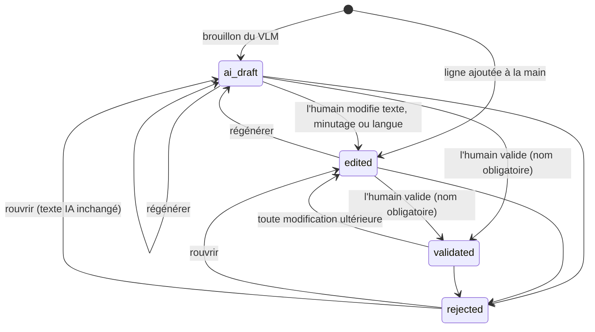

# Architecture

Wasf tourne en **un seul processus** sur la machine de l'utilisateur·rice : un serveur FastAPI qui sert l'application
React (page unique), exécute les tâches d'IA et de traitement vidéo dans un pool de threads interne, et stocke tout
dans SQLite et dans des fichiers locaux sous `./data`.

## Choix de conception

| Choix | Pourquoi |
|---|---|
| **Le VAD fait foi pour le minutage** ; les segments ASR ne comblent que ce que le VAD a manqué | Les segments de Whisper débordent souvent sur les silences : leur faire confiance effaçait tous les silences de la vidéo d'exemple. Le minutage du VAD et une marge de sécurité de 0,25 s garantissent qu'une description ne chevauche jamais la parole. |
| **Les longs silences sont découpés en créneaux d'environ 10 s** (`split_long_gaps`, aux changements de plan) | Les audiodescripteur·rice·s humain·e·s décrivent un long passage muet en plusieurs fois, environ toutes les 10 à 25 s (constat tiré des données QuerYD, voir [ml/README.md](../ml/README.md)). |
| **Un modèle ML donne un score à chaque créneau** (`pipeline/gapscore.py`) | Il apprend où les humains placent leurs descriptions. Le VLM ne rédige que dans les créneaux retenus ; les autres restent disponibles avec « Rédiger ici » (`POST /api/gaps/{id}/draft`). Sans modèle entraîné, tous les créneaux sont retenus. |
| **Seuls les silences et 1 à 3 images clés par créneau** sont envoyés au VLM | Un film de 90 min compte environ 130 000 images ; nous en envoyons quelques centaines. Moins de coût, moins d'énergie, moins de données confiées à des tiers. |
| **Fournisseurs derrière de petites interfaces** (`providers/asr.py`, `vision.py`, `tts.py`) | On remplace Whisper par un fine-tune tunisien, Gemini par un VLM local via un serveur compatible OpenAI, ou edge-tts par Piper, avec une simple variable d'environnement. |
| **La validation est un appel d'API séparé, explicite et nominatif** (`POST /api/descriptions/{id}/validate`) | Aucun chemin de code ne passe une ligne à `validated` automatiquement. Toute modification après validation repasse la ligne à `edited`. |
| **L'export ne contient que les lignes validées par un humain** | Rien n'atteint le public sans validation humaine. |
| **File de tâches dans le processus** | Pas besoin de Redis pour un prototype ; une tâche interrompue par un redémarrage est marquée en erreur au démarrage suivant. |
| **Contrôle des intervalles côté serveur** | `PATCH`/`POST` sur les descriptions refusent tout intervalle qui chevauche la parole détectée (HTTP 422). |
| **Le marquage DEMO MODE se propage partout** | Indicateur `demo` sur chaque ligne, bannière dans l'interface, `NOTE` dans le VTT, `ttm:desc` dans le TTML, métadonnée `comment` du MP4, `credits.txt`. |

## Modèle de données (SQLite)

`Project` · `TranscriptSegment` · `SpeechRegion` · `Gap` (avec `score` et `recommended`) · `Keyframe` · `Description`
(état, origine, indicateurs, confiance, fournisseur/modèle, texte IA d'origine, validateur·rice et date, historique
JSON, audio) · `Job` · `Feedback`.

Les fichiers sont rangés dans `data/projects/<id>/` : `source.*`, `audio.wav`, `frames/*.jpg`, `voice/*.wav`,
`export/*`. Les chemins sont enregistrés relativement à `DATA_DIR` : passer à un stockage objet ne demande que de
modifier `service.absolute/rel`.

## Cycle de vie d'une ligne de description

| État (API) | Libellé dans l'interface |
|---|---|
| `ai_draft` | BROUILLON IA |
| `edited` | MODIFIÉ PAR UN HUMAIN |
| `validated` | VALIDÉ PAR UN HUMAIN (nom et date) |
| `rejected` | REJETÉ |
