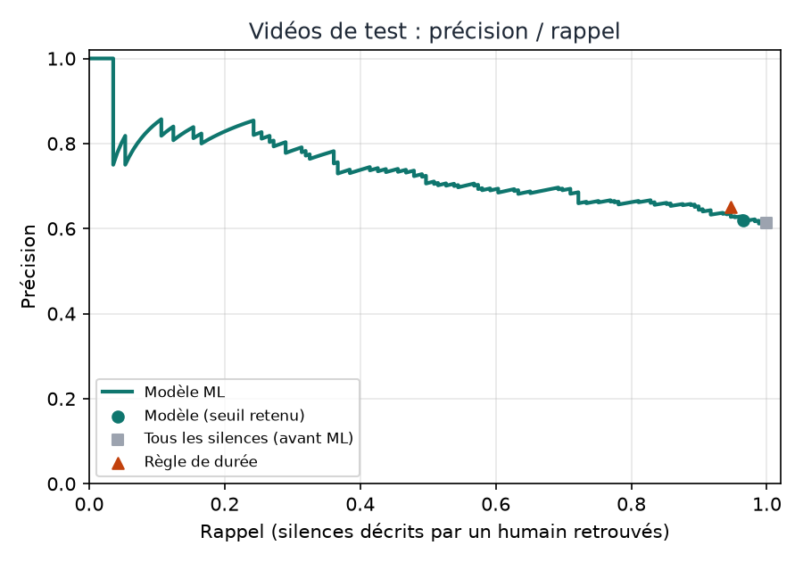

# Apprentissage automatique : quels silences décrire ?

Wasf trouve tous les silences d'au moins 1,5 s. Mais un·e audiodescripteur·rice humain·e ne les décrit pas tous : seulement ceux où quelque chose d'important se passe à l'image. Ce dossier entraîne un **modèle qui apprend où les humains placent leurs descriptions**. Wasf l'utilise ensuite pour ne faire rédiger Gemini que dans les silences pertinents.

| | Rôle | Entraîné par nous ? |
|---|---|---|
| VAD + Whisper | trouver les silences | non |
| **Modèle de ce dossier** | **choisir les silences à décrire** | **oui, sur 17 vidéos** |
| Gemini | écrire *ce qui se passe* à l'image | non (pré-entraîné) |
| edge-tts + FFmpeg | voix et mixage | non |

## Données : QuerYD (descriptions humaines)

[QuerYD](https://www.robots.ox.ac.uk/~vgg/data/queryd/) (université d'Oxford, ICASSP 2021) rassemble des vidéos YouTube audiodécrites par les bénévoles de [YouDescribe](https://youdescribe.org). Pour chaque description, les métadonnées donnent :

- le moment où elle commence dans la vidéo ;
- son type : `inline` (dite par-dessus la vidéo, exactement le cas de Wasf) ou `extended` (la vidéo est mise en pause) ;
- sa transcription.

Les noms et e-mails des bénévoles présents dans les métadonnées brutes **ne sont pas conservés**.

Sélection par défaut : 1 à 5 minutes, description anglaise publiée, au moins 6 descriptions, au moins 60 % de descriptions `inline`, catégorie « Film & Animation » en priorité. Environ 450 vidéos remplissent ces critères ; on en prend 30.

## Lancer tout le processus

```bash
pip install -r ml/requirements.txt
python ml/run_all.py --train 17 --test 13     # ou : make ml
```

Durée indicative : 15 à 30 minutes sur CPU (surtout le téléchargement). Redémarrez ensuite Wasf : le modèle est chargé automatiquement depuis `ml/artifacts/`.

Étape par étape :

| Script | Ce qu'il fait | Sortie |
|---|---|---|
| `fetch_queryd.py` | télécharge les métadonnées QuerYD (68 Mo) et sélectionne les vidéos candidates | `ml/data/candidates.json` |
| `download.py` | télécharge les vidéos (yt-dlp, 480p) jusqu'à en avoir 30, puis les répartit **par vidéo** : 17 entraînement / 13 test | `ml/data/videos/`, `dataset.json` |
| `features.py` | fait tourner **le pipeline de Wasf** sur chaque vidéo (audio, VAD, silences, plans) et calcule 24 variables par silence ; étiquette 1 si un humain a commencé une description dans ce silence (tolérance 1 s) | `features.csv` |
| `train.py` | compare régression logistique, forêt aléatoire et gradient boosting en validation croisée **groupée par vidéo** ; garde le meilleur ; choisit le seuil sur l'entraînement uniquement | `ml/artifacts/gap_scorer.joblib` |
| `evaluate.py` | évalue sur les 13 vidéos **jamais vues** ; compare à « tous les silences » et à une règle de durée ; intervalles de confiance par bootstrap ; importance des variables ; frises | `ml/reports/report.md` + figures |

Options utiles : `features.py --asr` (ajoute Whisper comme dans l'application, plus lent), `train.py --beta 2` (seuil qui privilégie le rappel : moins de silences oubliés), `run_all.py --skip-download` (ré-entraîner sans retélécharger).

## Résultats (30 vidéos : 17 entraînement, 13 test)

Rapport complet : [reports/report.md](reports/report.md).

**Découverte faite grâce aux données.** Au départ, Wasf donnait un seul brouillon par silence, même pour un passage muet de 150 s. Les humains, eux, décrivent environ toutes les 10 à 25 s. Les longs silences sont maintenant **découpés en créneaux d'environ 10 s**, aux changements de plan quand c'est possible (`MAX_SLOT_SECONDS`, même code dans l'application et ici). Avec ce découpage, **91 % des descriptions humaines** (407 sur 448) commencent dans un créneau où Wasf peut rédiger.

**Sélection des créneaux, sur 13 vidéos jamais vues** (276 créneaux, dont 61 % décrits par un humain) :

| Méthode | Précision | Rappel | F1 | Créneaux rédigés |
|---|---|---|---|---|
| Tous les créneaux (sans ML) | 61 % | 100 % | 0,76 | 100 % |
| Règle de durée (≥ 3 s, apprise) | 65 % | 95 % | 0,77 | 89 % |
| Modèle ML (régression logistique) | 62 % | 96 % | 0,75 | 95 % |

- Validation croisée sur l'entraînement : la régression logistique (AP 0,79) bat la forêt aléatoire (0,70) et le gradient boosting (0,71). Avec si peu de données, un modèle simple généralise mieux.
- Le modèle apprend un vrai signal : sur le test, sa précision moyenne (AP) est de 0,74 contre 0,61 au hasard (IC 95 % par rééchantillonnage des vidéos : 0,67–0,81). Variables les plus utiles : durée du créneau, niveau sonore relatif, premier créneau de la vidéo, changement de luminosité.
- **Mais il ne bat pas encore « décrire tous les créneaux »**. Les humains en décrivent déjà 61 %, et 17 vidéos bénévoles donnent un signal faible. Le seuil appris garde donc 95 % des créneaux : le modèle ne dégrade rien, mais n'économise presque rien.
- La suite : `python ml/run_all.py --train 80 --test 20` (une centaine de vidéos, sans changer le code) et des films tunisiens annotés.



## Les 24 variables

Toutes sont calculées par [`backend/app/pipeline/gapscore.py`](../backend/app/pipeline/gapscore.py), **le même code** que dans l'application :

- **durée et position** : durée, rang de durée dans la vidéo, position relative, premier/dernier silence ;
- **dialogue autour** : parole avant et après, densité de parole sur 30 s, durée des silences voisins ;
- **montage** : changements de plan dans le silence, juste avant, dans les 10 s précédentes ;
- **image** : mouvement moyen et maximal, luminosité, changement de luminosité, nouveauté par rapport à 5 s avant (miniatures 32×18 en niveaux de gris, aucun visage, aucune identité) ;
- **son** : niveau, niveau relatif, part de son actif (musique, bruitages), centroïde spectral.

## Dans l'application

- Chaque silence reçoit un score de pertinence (0–100 %), visible dans **Analyse → Silences disponibles**.
- Gemini ne rédige que dans les silences **prioritaires** (score ≥ seuil). Les autres apparaissent en pointillés dans la frise.
- Le bouton **« Rédiger ici »** permet toujours à l'humain de demander un brouillon dans un silence écarté. **Le modèle propose, l'humain décide.**
- Configuration : `GAP_SELECTION=auto|model|all`, `GAP_SCORE_THRESHOLD` (0 = seuil appris), `GAP_MODEL_PATH`.

## Vos propres vidéos annotées (ex. films tunisiens)

Ajoutez vos vidéos dans `ml/data/videos/` et des entrées dans `ml/data/dataset.json` :

```json
{"youtube_id": "court_metrage_01", "title": "…", "category": "Film & Animation", "duration": 240,
 "split": "train", "path": "videos/court_metrage_01.mp4",
 "clips": [{"start": 12.5, "duration": 3.0, "type": "inline", "text": "Une femme ouvre une porte bleue."}]}
```

puis `python ml/run_all.py --skip-download`. Les identifiants doivent être uniques et chaque vidéo n'appartient qu'à un seul ensemble (`train` ou `test`).

## Vidéos pour tester l'application

- Les **13 vidéos de test** (`ml/data/videos/`, liste dans `dataset.json` avec `"split": "test"`) : importez-les dans Wasf et comparez avec la description humaine. Le rapport donne leurs liens YouTube.
- Films ouverts de la Blender Foundation (CC-BY) : *Tears of Steel* (dialogues + action), *Sintel*, *Spring*, *Sprite Fright* — [studio.blender.org/films](https://studio.blender.org/films/).
- Wikimedia Commons et Internet Archive (collection Prelinger, films du domaine public, dont le cinéma muet français).

## Limites (à dire au jury)

- 30 vidéos, c'est peu : les intervalles de confiance du rapport sont larges. C'est une preuve de concept.
- Les descriptions sont bénévoles, en anglais, sur des vidéos YouTube. Le modèle apprend **où** décrire, pas **quoi** ni **dans quelle langue**. Le transfert vers des films tunisiens reste à vérifier avec des vidéos annotées localement.
- Les bénévoles ne décrivent pas tous les silences utiles : la précision mesurée est une estimation prudente.
- Licences : vidéos téléchargées pour la recherche, utilisées localement, jamais redistribuées ; respectez les conditions de YouTube. Ne publiez pas `ml/data/`.
