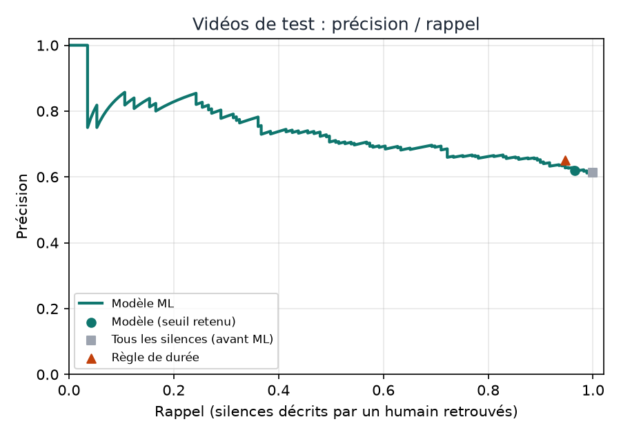
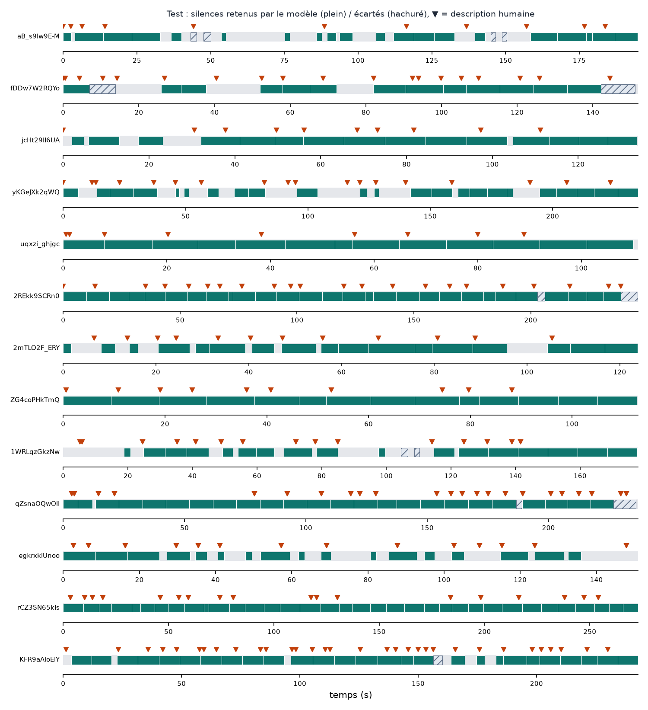
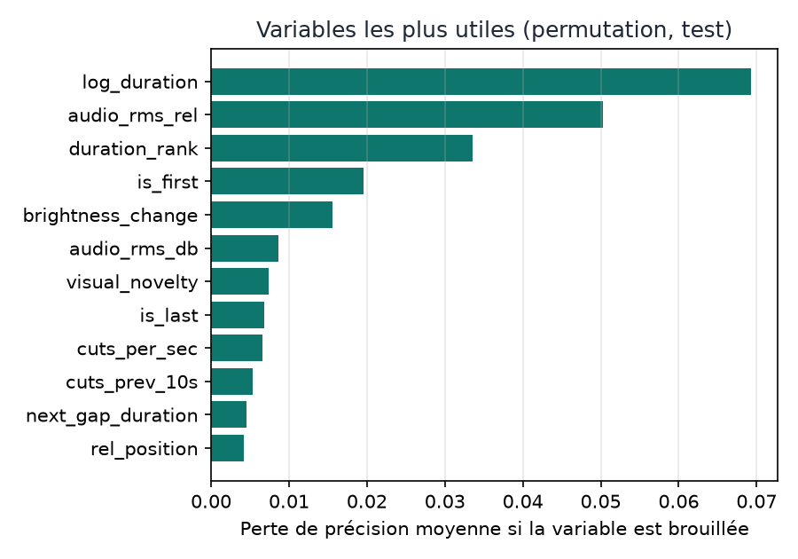

# Rapport d'évaluation : sélection des silences à décrire

Modèle **logistic_regression**, seuil **0.140**, entraîné sur 17 vidéos (296 silences), évalué sur **13 vidéos de test jamais vues** (276 silences, 61 % décrits par un humain).

Question posée au modèle : *un·e audiodescripteur·rice humain·e aurait-il·elle placé une description dans ce silence ?* Vérité terrain : descriptions bénévoles QuerYD / YouDescribe.

## Résultats sur le test

| Méthode | Précision | Rappel | F1 | Silences rédigés |
|---|---|---|---|---|
| Tous les silences (Basira avant ML) | 61 % | 100 % | 0.76 | 100 % |
| Règle de durée (≥ 3.0 s, apprise) | 65 % | 95 % | 0.77 | 89 % |
| **Modèle ML** | **62 %** | **96 %** | **0.75** | **95 %** |

- Précision moyenne (AP) : **0.74** (IC 95 % par rééchantillonnage des vidéos : 0.67 – 0.81) ; ROC-AUC : 0.64.
- F1 du modèle : IC 95 % 0.70 – 0.80.
- Descriptions humaines du test : 213 ; 195 tombent dans un silence détecté, dont **190** dans un silence retenu par le modèle. Les autres sont des descriptions « extended » (la vidéo est mise en pause) ou posées sur de la parole.

## Variables les plus utiles

| Variable | Importance (perte d'AP) |
|---|---|
| `log_duration` | 0.069 |
| `audio_rms_rel` | 0.050 |
| `duration_rank` | 0.034 |
| `is_first` | 0.020 |
| `brightness_change` | 0.016 |
| `audio_rms_db` | 0.009 |
| `visual_novelty` | 0.007 |
| `is_last` | 0.007 |
| `cuts_per_sec` | 0.007 |
| `cuts_prev_10s` | 0.005 |

## Validation croisée sur l'entraînement (par vidéo)

| Modèle | AP | ROC-AUC |
|---|---|---|
| logistic_regression | 0.794 | 0.668 |
| random_forest | 0.702 | 0.554 |
| gradient_boosting | 0.709 | 0.587 |

## Détail par vidéo de test

| Vidéo | Silences | Décrits (humain) | Retenus (modèle) | Précision | Rappel |
|---|---|---|---|---|---|
| [aB_s9lw9E-M](https://www.youtube.com/watch?v=aB_s9lw9E-M) Harry Confronts Snape - Harry Potter and | 24 | 9 | 20 | 40 % | 89 % |
| [fDDw7W2RQYo](https://www.youtube.com/watch?v=fDDw7W2RQYo) Planet of Snail - Official Trailer | HD | 15 | 13 | 13 | 85 % | 85 % |
| [jcHt29II6UA](https://www.youtube.com/watch?v=jcHt29II6UA) Ratatouille: Linguini "learns" to Cook | 15 | 7 | 15 | 47 % | 100 % |
| [yKGeJXk2qWQ](https://www.youtube.com/watch?v=yKGeJXk2qWQ) BUTTER LOVER | 23 | 12 | 23 | 52 % | 100 % |
| [uqxzi_ghjgc](https://www.youtube.com/watch?v=uqxzi_ghjgc) CGI 3D Animated Short HD: "The Right Way | 13 | 8 | 13 | 62 % | 100 % |
| [2REkk9SCRn0](https://www.youtube.com/watch?v=2REkk9SCRn0) In a Heartbeat - Animated Short Film | 30 | 20 | 28 | 68 % | 95 % |
| [2mTLO2F_ERY](https://www.youtube.com/watch?v=2mTLO2F_ERY) Mr. W | 17 | 10 | 17 | 59 % | 100 % |
| [ZG4coPHkTmQ](https://www.youtube.com/watch?v=ZG4coPHkTmQ)  | 14 | 9 | 14 | 64 % | 100 % |
| [1WRLqzGkzNw](https://www.youtube.com/watch?v=1WRLqzGkzNw) Double Indemnity (8/9) Movie CLIP - Good | 19 | 11 | 17 | 65 % | 100 % |
| [qZsnaOQwOlI](https://www.youtube.com/watch?v=qZsnaOQwOlI) Best Horror Scenes: Wait Until Dark (196 | 26 | 17 | 24 | 67 % | 94 % |
| [egkrxkiUnoo](https://www.youtube.com/watch?v=egkrxkiUnoo) Forrest Gump (1/10) Best Movie Quote - L | 17 | 12 | 17 | 71 % | 100 % |
| [rCZ3SN65kIs](https://www.youtube.com/watch?v=rCZ3SN65kIs) The Lord of the Rings - Best Scene (HD) | 35 | 18 | 35 | 51 % | 100 % |
| [KFR9aAloEiY](https://www.youtube.com/watch?v=KFR9aAloEiY) The Hunger Games: Catching Fire Movie CL | 28 | 23 | 27 | 81 % | 96 % |

## Limites

- Peu de vidéos : les intervalles de confiance sont larges ; à présenter comme une preuve de concept.
- Descriptions bénévoles, en anglais, sur YouTube : le modèle apprend *où* décrire, pas *quoi* ni dans quelle langue. La rédaction reste faite par le VLM et validée par un humain.
- Les bénévoles ne décrivent pas tous les silences utiles : un silence « non décrit » n'est pas forcément un mauvais endroit. La précision est donc une estimation prudente.
- Dans l'application, l'humain peut toujours rédiger dans un silence écarté par le modèle.
